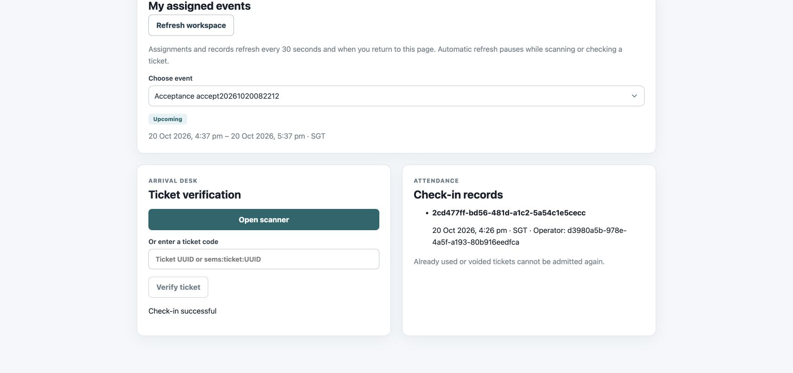
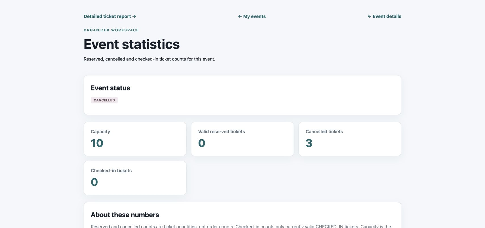

# 2026-10-20 云端交付验收

业务基线：`270c2b87322f89555d54222b825da82e0694fa54`；[成功main CI/CD](https://github.com/seventh720/SWE5006-SEMS/actions/runs/39311200552)。目标：`https://swe5006.seventh720.com`。以下时间均为SGT。

## 手机扫码反馈

维护者于10月20日明确确认“交付验收手机扫码没问题了”，状态记为通过。未提供具体设备/系统/浏览器与录像，未补写这些信息。本轮代理没有重新执行物理手机摄像头扫码。

## 云端多角色流程（约16:22–16:31）

使用4个虚构测试账号与一个标题以`Acceptance`开头的专用活动。经维护者明确授权，临时给新建测试账号设置ADMIN；其余角色分配通过正式管理API执行，未使用真实管理员口令。没有改动原有业务账号或活动。

API准备组织者、Staff、活动、免费票种、分配及2张票订单。Chrome独立参与者会话实际显示两张不同QR，均为320×320的data图片；Staff会话通过页面输入票码、Verify ticket、Confirm check-in完成核销。组织者页面统计为有效预订2、取消0、有效签到1。浏览器核销使用手动票码路径；手机摄像头结果沿用维护者反馈。

随后通过真实HTTPS API验证：

- 重复核销409；含已核销票的个人取消409；其他账号读取票券404。
- 核销审计只有1条，操作者为已分配Staff。
- 修改地点产生EVENT_UPDATED通知；撤销活动分配后验票403，重新分配恢复。
- 撤销STAFF角色后，旧Bearer请求403；收到ROLES_CHANGED，恢复角色后重新登录，JWT有效期3600秒。
- 另一笔未使用的1张票订单可以取消。
- 活动取消后两张原票均VOID、已核销时间保留；旧票验票409，公开活动详情404。
- 最终统计为有效预订0、取消3、有效签到0；核销审计仍为1条。

证据：[API检查结果](cloud-api-results.json)、[核销页面状态](cloud-check-in.txt)、[最终统计页面状态](cloud-final-statistics.txt)。应用操作以浏览器及API分别记录，未把API步骤称为全程浏览器E2E。

结束后临时ADMIN/ORGANIZER/STAFF角色全部撤除，4个测试账号停用，旧token均401。专用活动已取消、订单/票/审计保留作为验收记录；凭据只保存在被Git忽略的私有目录，不提交。

## 账号清理补充（2026-10-21）

维护者要求删除管理列表中的`accept20261020082212_`四个验收账号。先在云端私有目录生成并校验备份，再按精确ID、用户名、停用状态和活动归属校验，以事务删除4个账号、4条角色、1场专用已取消活动、2笔测试订单、3张票、1条核销审计、1条Staff分配及17条测试通知。没有其他用户参与这场测试活动；其余账号、活动等数据指纹未变。

[清理结果](account-cleanup-2026-10-21.json)：四个账号剩余0，云端保留2个原有账号、2场原有活动；两套系统6个健康检查通过。原验收截图、API结果及恢复报告保留，仍表示当时的真实测试结果；这些测试订单/票/审计已不在当前业务库中。后续演示须重新准备账号和活动。

## 备份恢复（16:31）

先恢复既有部署前备份，再对本轮验收后的数据库生成私有custom-format备份，并恢复到全新临时库；另建空库解析当前DDL用于结构比较。业务库只做备份读取，没有覆盖或回滚业务库。

最终恢复记录：[restore-results.json](restore-results.json)。12张表行数与检查时业务库一致，含2笔订单、3张票、1条核销审计、14条Flyway记录；迁移版本/校验和匹配，未验证约束数量0。PostgreSQL对数组类型转换的反解析格式有所不同，经服务器重新解析后结构摘要一致。两个临时库均删除。

备份文件仅约几十KiB；备份恢复及校验耗时约2.34秒，不将其宣称为生产故障RTO、整机恢复或异地灾备。备份留在服务器私有目录，仓库只保存不含个人记录的校验摘要。复现工具：[restore-check.py](../../../scripts/acceptance/restore-check.py)。

## 读取性能基线（约16:29–16:31）

本地Docker的k6 1.3.0通过公网HTTPS访问同一云端，独立运行1/5/10 VU，各20秒。每次迭代顺序GET公开活动列表、测试账号本人资料、本人订单列表，再等待1秒；没有重复登录、下单或修改业务数据。接口顺序相同，测量时测试订单已经取消。每个请求同时核对HTTP200与JSON结构。

| VU | 计划持续时间 | 请求数 | 吞吐(req/s) | 整体p95 | HTTP错误率 |
|---:|---|---:|---:|---:|---:|
| 1 | 20秒 | 57 | 2.82 | 31.14 ms | 0.00% |
| 5 | 20秒 | 285 | 13.88 | 41.31 ms | 0.00% |
| 10 | 20秒 | 570 | 27.32 | 55.66 ms | 0.00% |

三档响应/内容检查均100%通过，p95<3000ms、错误率<1%的阈值通过。原始k6摘要：[1 VU](performance-1-vu.json)、[5 VU](performance-5-vu.json)、[10 VU](performance-10-vu.json)。[资源采样](resource-summary.json)：16:28:48–16:30:43共20次采样，最低可用内存约1640MiB；后端采样CPU峰值57.81%（docker stats单核100%口径）。服务器还承载SWE5001，数值包含当时共享环境影响。

这是小数据量、热态、短时、带思考时间的读取基线，不能证明1000并发、持续容量、登录/写入吞吐或热门活动行锁竞争。读取脚本：[read-baseline.js](../../../scripts/acceptance/read-baseline.js)。新一轮测量须重新准备有效测试账号，将base/token/attendeeId放在私有JSON中，通过`K6_CREDENTIALS`读取，不把token写入命令行或Git。

## 复现与清理

[cloud-flow.py](../../../scripts/acceptance/cloud-flow.py)分阶段执行：`seed`注册虚构账号；经当轮明确授权由维护者给该轮新账号临时ADMIN，再执行`prepare`；浏览器核销后执行`verify --already-checked-in`，不使用浏览器时则执行`verify`。`demote`撤除全部临时角色。账号停用由维护者核对本轮ID后执行，最后用`confirm-disabled`验证旧token被拒绝。脚本不自动授予ADMIN或停用账号；故障中断后也需完成撤权和停用。

各阶段均使用`python3 scripts/acceptance/cloud-flow.py <phase> --state .secrets/cloud-acceptance/accounts.json --report /tmp/cloud-acceptance-report.json`，复测须使用全新的state/report路径。state包含随机口令及token，仅保存在私有目录；报告只记录状态及断言。本次临时授权不延伸到未来运行。`prepare`创建的活动12分钟后开始，核销与取消步骤应在允许窗口内完成。

## 后续交付

当前剩余工作与完成状态统一见[交付清单](../../remaining-work.zh-CN.md)，不在历史验收记录重复维护。

后续同一云主机的容量结果见[最新云端容量验证](../capacity-2026-10-21/README.md)，与本文业务验收、恢复和小规模基线分别记录。
