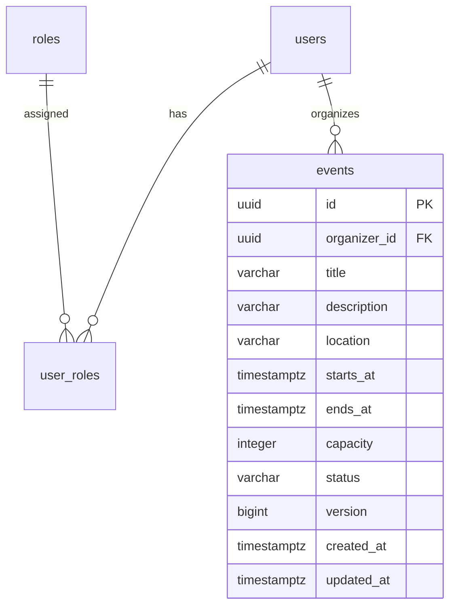
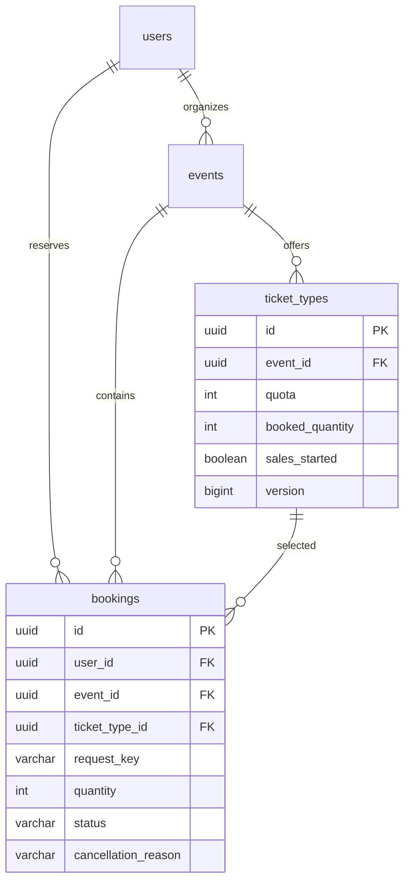
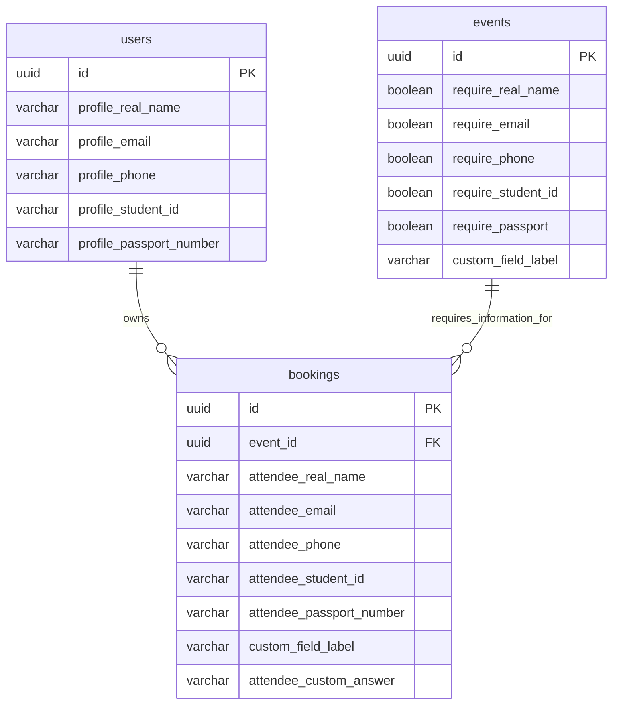
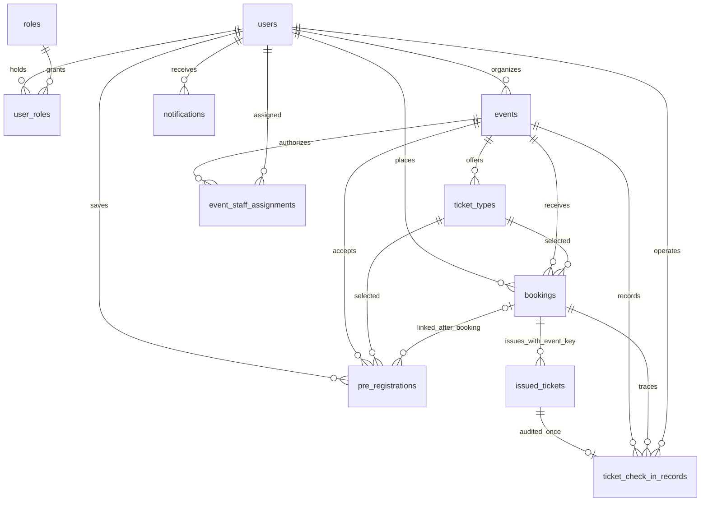

# SEMS database management

PostgreSQL is the system database. Flyway SQL files under `backend/src/main/resources/db/migration` are the source of truth for its schema. Navicat is a supported local client for viewing data and testing queries.

Reviewed on 21 October 2026 against all **14 migrations**: **11 application tables**, plus Flyway's history table. The sections below retain the schema's evolution; the [current core ERD](#current-core-erd) includes tickets, staff assignments, check-in audit and notifications for presentation use.

## Rules

1. Create a new timestamped Flyway migration for every schema change.
2. Do not edit a migration after it has been merged or executed in a shared environment.
3. Keep Hibernate `ddl-auto` set to `validate`.
4. Commit schema migrations, reference data, ERD sources and the data dictionary.
5. Do not commit database dumps, PostgreSQL data files, passwords or personal Navicat connection files.
6. Test migrations from an empty PostgreSQL database before merging.

## Sprint 1 tables

| Table | Purpose |
|---|---|
| `users` | Login identity, password hash, status and audit timestamps |
| `roles` | Four supported system roles |
| `user_roles` | Many-to-many assignment of users to roles |

## Sprint 2 events

Migration: `V202609211600__create_events.sql`. No sample events are inserted.

| Column | PostgreSQL type | Meaning / constraint |
|---|---|---|
| `id` | UUID | Primary key |
| `organizer_id` | UUID | Required reference to `users.id`; no cascading deletion |
| `title` | VARCHAR(200) | Required, nonblank |
| `description` | VARCHAR(10000) | Required, nonblank |
| `location` | VARCHAR(500) | Required, nonblank |
| `starts_at`, `ends_at` | TIMESTAMPTZ | Required; start strictly before end |
| `capacity` | INTEGER | Required positive event size; Sprint 3 uses it as the ceiling for total ticket quota |
| `status` | VARCHAR(20) | Required; DRAFT (default), PUBLISHED or CANCELLED |
| `version` | BIGINT | Required optimistic-lock version, default 0 |
| `created_at`, `updated_at` | TIMESTAMPTZ | Required; default current timestamp on insert |

Indexes: published events by `(starts_at, id)` (partial index); organizer events by `(organizer_id, created_at DESC, id DESC)`. Substring search currently scans matching published titles; it does not use a full-text index. Public reads always filter `PUBLISHED`. Draft creation and editing now set audit timestamps through JPA lifecycle callbacks. Edit requests compare the supplied version, and JPA optimistic locking prevents concurrent overwrites. Writes use the authenticated organizer ID. Drafts and published records are editable; booking requirements are fixed after publication. Ended published events cannot be edited; started published events keep their original start/end times. Use Copy to new draft to organize a new occurrence. Publication requires a future start time. Allowed transitions are DRAFT → PUBLISHED, DRAFT → CANCELLED, and PUBLISHED → CANCELLED. State transitions check the supplied version and use the same optimistic lock as editing. Cancelled records are retained and cannot be restored.

`EventBrowseIntegrationTest` runs against PostgreSQL 17 and verifies both empty-schema migration and upgrading Sprint 1 with existing user and role data. Run with `RUN_CONTAINER_TESTS=true mvn test` from `backend/`.

## Sprint 3 ticket types and bookings

Migrations: `V202610060400__create_ticket_types.sql` (existing ticket types) and `V202610060500__create_bookings.sql` (booking workflow and first-sale marker). Applied migrations are unchanged. The latter backfills `sales_started=true` where inventory is already booked; no orders are fabricated for historical inventory counters.

### Ticket types

| Column | Type | Meaning / constraint |
|---|---|---|
| id / event_id | UUID | Primary key / event FK |
| name | VARCHAR(100) | Nonblank ticket name |
| price_minor | BIGINT | Nonnegative SGD cents |
| currency | VARCHAR(3) | SGD only |
| quota | INTEGER | Positive quota; event-wide sum validated under the event lock |
| booked_quantity | INTEGER | Between 0 and quota |
| sales_started | BOOLEAN | Permanent first-booking marker; remains true after inventory release |
| version | BIGINT | Optimistic ticket edit version |
| created_at / updated_at | TIMESTAMPTZ | Audit times |

### Bookings

| Column | Type | Meaning / constraint |
|---|---|---|
| id | UUID | Primary key |
| user_id / event_id / ticket_type_id | UUID | Required FKs; history cannot be deleted by deleting its parent |
| request_key | VARCHAR(100) | Nonblank; unique together with user_id |
| quantity | INTEGER | 1–10 tickets |
| unit_price_minor / total_amount_minor | BIGINT | Free bookings only in Sprint 3; total equals unit price × quantity |
| currency | VARCHAR(3) | SGD |
| event_title / event_location | VARCHAR(200) / VARCHAR(500) | Historical event snapshot |
| event_starts_at / event_ends_at | TIMESTAMPTZ | Historical event times |
| ticket_type_name | VARCHAR(100) | Historical ticket name |
| status | VARCHAR(20) | CONFIRMED or CANCELLED |
| payment_status | VARCHAR(20) | NOT_REQUIRED |
| cancellation_reason | VARCHAR(30), nullable | ATTENDEE_CANCELLED or EVENT_CANCELLED; required exactly when cancelled |
| created_at / updated_at | TIMESTAMPTZ | Audit times |

Indexes support `(user_id, created_at DESC, id DESC)` and `(event_id, created_at DESC, id DESC)`. The idempotency unique constraint is `(user_id, request_key)`. PostgreSQL transaction advisory locks serialize same-key requests before taking the event row lock. All supported inventory writers hold the event row lock; cancellation reads the booking after acquiring it. See the [transaction contract](../sprint-3-api.zh-CN.md).

## Booking information and saved profiles

Migrations: `V202610061200__add_booking_information.sql`, followed by `V202610070900__reusable_profiles_and_booking_fields.sql`. Previously applied migrations remain unchanged.

| Table / columns | Type | Meaning |
|---|---|---|
| events.require_real_name / require_email / require_phone / require_student_id / require_passport | BOOLEAN NOT NULL DEFAULT FALSE | Required fields per order; editable in draft only |
| events.custom_field_label | VARCHAR(100), nullable | Organizer's question; a non-null label requires an answer |
| bookings.attendee_real_name | VARCHAR(100), nullable | Order contact's real name |
| bookings.attendee_email | VARCHAR(255), nullable | Order contact email, independent of login email |
| bookings.attendee_phone | VARCHAR(30), nullable | Contact phone |
| bookings.attendee_student_id / attendee_passport_number | VARCHAR(100), nullable | Independent document numbers |
| bookings.custom_field_label | VARCHAR(100), nullable | Question snapshot |
| bookings.attendee_custom_answer | VARCHAR(500), nullable | Answer snapshot |
| users.profile_real_name / profile_student_id / profile_passport_number | VARCHAR(100), nullable | Optional saved booking defaults; excluded from UserView |
| users.profile_email | VARCHAR(255), nullable | Optional saved contact email |
| users.profile_phone | VARCHAR(30), nullable | Optional saved contact phone |

Existing orders retain snapshots independently of profile changes. Only the current user's `/profile` API exposes saved defaults; order details are exposed through the attendee's own orders and the owning organizer's order list. Profiles do not populate booking requests automatically on the server.

The earlier generic `require_document` and `attendee_document_type/number` columns are retained as legacy data. The new migration converts earlier requirements to a custom identity-document question and copies earlier type/number values into the historical custom answer, preserving their meaning. New application writes use the independent fields above.

Event copying creates a new draft and new ticket types in one transaction, with zero booked quantity and no first-sale marker. No orders or user information are copied.

## Registration deadline

Migration: `V202610071200__add_registration_deadline.sql` adds `events.registration_closes_at` (`TIMESTAMPTZ`). Existing rows are backfilled from `starts_at`. The database constraint rejects deadlines after the event start. A null value from a legacy writer is read as `starts_at`; new event API writes persist the effective deadline.

Publication requires an unexpired deadline. New reservations check it under the event row lock before reserving inventory. Existing idempotent requests and pre-start cancellation remain supported after registration closes. Public and management event views expose the effective deadline, and event copies retain it.

## Registration opening and private pre-registrations

`V202610071500__registration_opening_and_pre_registrations.sql` adds nullable `events.registration_opens_at`, constrained to precede the effective registration deadline. Null means booking is available on publication.

`pre_registrations` stores one entry per `(user_id, event_id)`: ticket type, quantity, private `attendee_info` JSONB, update timestamp and an optional reference to the first subsequent booking. Foreign keys retain referential integrity. Saves and deletes take the event lock used by booking; saving never changes inventory or the first-sale flag. The list is indexed by user and update time. Saved information is exposed only to its owner; organizer order access receives the actual booking snapshot after explicit booking.

## Event illustrations and avatars

`V202610072200__event_illustrations_and_avatars.sql` adds `events.illustration` with default `GENERAL` and a database allowlist (`GENERAL`, `TECH`, `MUSIC`, `SPORT`, `ART`, `SOCIAL`). Existing events receive the general illustration. Draft editing and copying preserve the selected value.

`users.avatar_data` is nullable TEXT containing a server-decoded and re-encoded PNG data URL. The own-profile avatar endpoint stores and reads it separately from user lists and booking details. Null means the default avatar. No filesystem upload directory or new environment variable is needed; database backup includes saved avatars. This bounded small-image storage suits the current project scope.

## Electronic tickets, staff and check-in audit

Sources: [issued-ticket migration](../../backend/src/main/resources/db/migration/V202610160100__create_issued_tickets.sql) and [staff/check-in migration](../../backend/src/main/resources/db/migration/V202610190100__staff_check_in.sql).

| Table / columns | Type and constraints | Purpose |
|---|---|---|
| `issued_tickets.id` | UUID PK | One admission credential per ticket, encoded in the QR |
| `booking_id`, `event_id` | UUID NOT NULL; composite FK to `bookings(id, event_id)` | Prevent a ticket referencing a booking from another event |
| `ordinal` | INTEGER 1–10; unique `(booking_id, ordinal)` | Stable ticket number within an order; prevents duplicate issuance |
| `status` | VARCHAR(20): VALID / CHECKED_IN / VOID | Lifecycle state |
| `checked_in_at`, `voided_at` | TIMESTAMPTZ, nullable | VALID has neither timestamp; CHECKED_IN requires check-in time only; VOID requires void time and may retain check-in time |
| `event_staff_assignments.event_id`, `staff_id` | Composite PK; FKs to events/users with ON DELETE CASCADE | Per-event assignment; global STAFF role and current account validity are also checked by the application |
| `ticket_check_in_records.id` | UUID PK | Permanent audit entry for a successful check-in |
| `ticket_id` | UUID NOT NULL UNIQUE FK to issued_tickets | At most one audit record per ticket |
| `event_id`, `booking_id`, `operator_id` | UUID NOT NULL FKs to events/bookings/users | Event, booking and the staff member who performed the operation |
| `checked_in_at` | TIMESTAMPTZ NOT NULL | Audit time |

Indexes support ticket lookup by event, staff assignment lookup by staff and audit lookup by event/time descending. Ticket issuance, check-in and cancellation share the event lock and transaction contract described in [cancellation integration](../sprint-4-cancellation.zh-CN.md). Event cancellation voids tickets while retaining check-in audit; reports count currently valid check-ins separately from historical admissions. The time window and authorization are application rules, not SQL CHECK constraints.

## Notifications

Sources: [notification migration](../../backend/src/main/resources/db/migration/V202610160200__create_notifications.sql) and [role-change extension](../../backend/src/main/resources/db/migration/V202610200100__role_change_notifications.sql).

| Columns | Type and constraints | Purpose |
|---|---|---|
| `id`, `user_id` | UUID PK; required recipient FK to users | Private recipient inbox |
| `type` | VARCHAR(40), database allowlist | STAFF_ASSIGNED, STAFF_REVOKED, BOOKING_CONFIRMED, BOOKING_CANCELLED, REGISTRATION_OPENING_SOON, EVENT_UPDATED, EVENT_CANCELLED, ROLES_CHANGED |
| `title`, `message` | VARCHAR(250) NOT NULL / TEXT NOT NULL | Message snapshot |
| `event_id`, `booking_id`, `ticket_type_id` | Nullable UUIDs, **no foreign-key constraints** | Optional navigation/context identifiers; target APIs still enforce access |
| `source_key` | VARCHAR(250) NOT NULL; unique `(user_id, type, source_key)` | Database protection against duplicate delivery for a business operation/reminder |
| `created_at`, `read_at` | Required creation timestamp / nullable read timestamp | Inbox sorting and read state |

Indexes cover recipient/creation-time/ID and unread recipients. Business notifications participate in the originating transaction; reminder timing, deduplication and polling are documented in [notification integration](../notification-integration.zh-CN.md). Reports use queries over existing tables; there is no separate reporting table.

## Current core ERD

All 11 application tables are included. Flyway's technical history table is omitted. Edges represent declared foreign keys; notification event/booking/ticket-type identifiers are contextual references without FK edges. Columns and composite constraints are detailed above and in the migration files.

