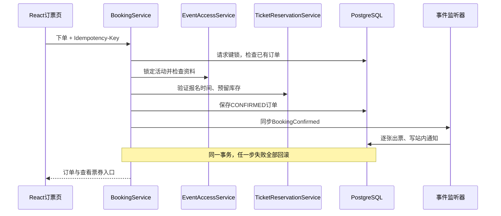
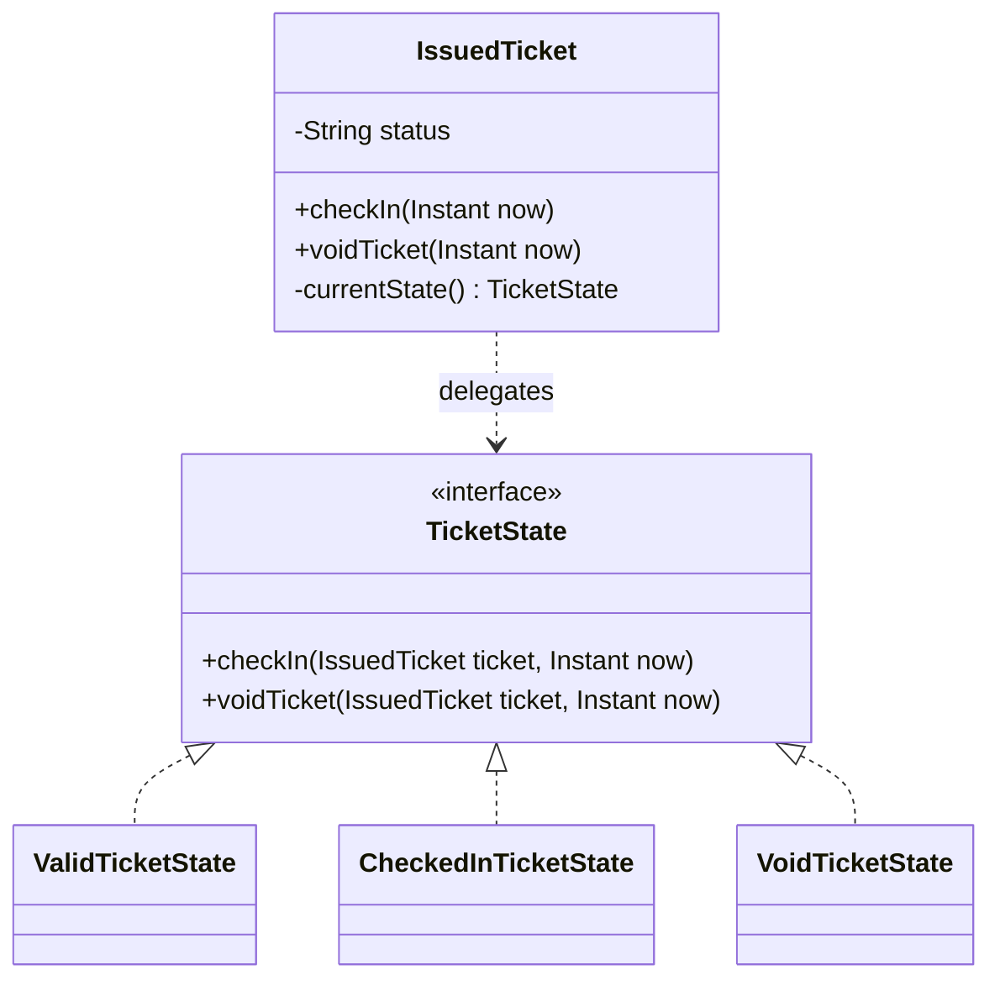
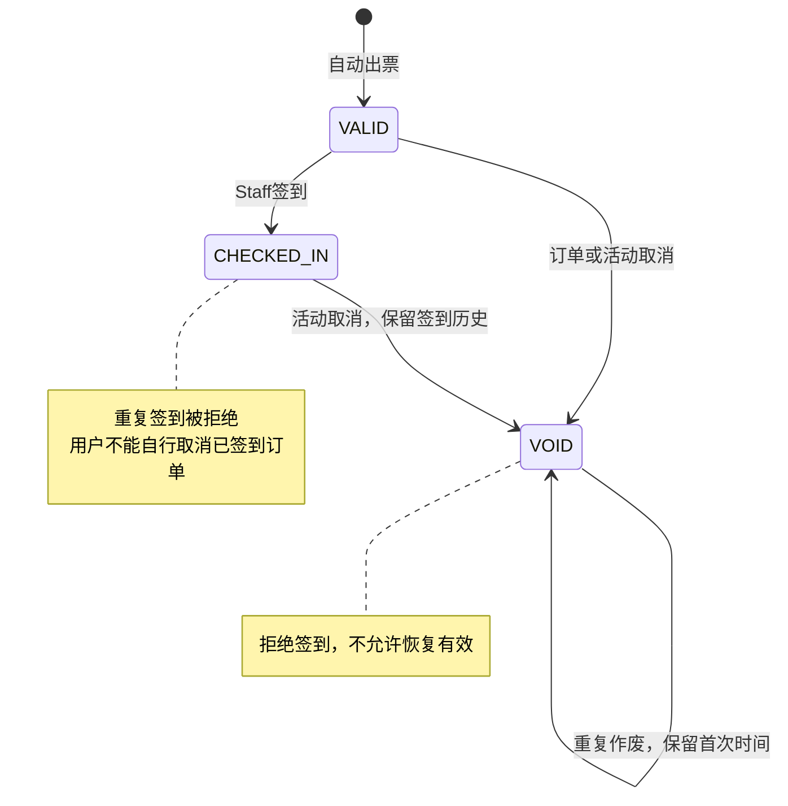
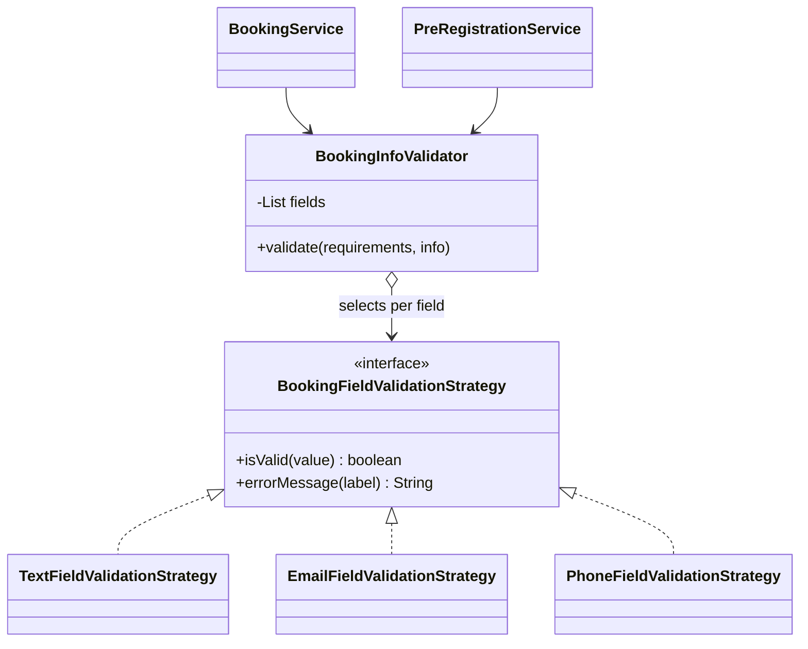

# Final report素材与证据

2026-10-27补充：已纳入Presentation反馈，增加核心用例的分析/设计对照、连接全部11张应用表的ERD、验证产物索引及原始输出附录。新的[CI证据](acceptance/report-evidence-2026-10-27/README.md)来自PR #50运行40445034465；DAST与性能继续使用各自已记录的部署基线。完整Word与独立证据包位于`outputs/final-report/`。

PR #50随后合并为`2583b59`，[main运行40448082772](https://github.com/seventh720/SWE5006-SEMS/actions/runs/40448082772)验证、staging部署/HTTPS及被动DAST通过。报告中新增该部署状态；附录内的原始输出及数值仍保留各自的运行与日期。

整理日期：2026-10-27（SGT）。本文供报告取材，按现有源码和已保存验收记录更新10月12日的consolidated材料，并纳入本次PR验证；未重新运行云端业务验收、DAST或压测。附件原件保留不改，报告章节责任分配不等同于独占代码作者。

## 个人用例对应

沿用原Word的分配，每人明确一个主要用例及对应设计问题；标记用于报告与演示责任，不代表独占代码作者。

| 成员 | 主要用例 | 对应设计问题 | 原材料章节 |
|---|---|---|---|
| Lu Junyi | UC04 Manage Events（另覆盖UC05 Browse Events） | DP01 取消协作：Observer | C4 |
| Hu Jia | UC02 Login（另覆盖UC01 Register） | DP02 可替换凭据校验：PasswordEncoder Strategy | C5 |
| Chai Muyang | UC03 Manage Users and Roles | DP03 角色变更通知分离：Observer | C6 |
| Huang Haoyang | UC06 Book Tickets | DP04 报名资料校验：Strategy | C7 |
| Luo Runzhou | UC07 Check In Ticket | DP05 票券生命周期行为：State | C8 |

## 历史材料修订

来源：`Materials_for_Final_Report_Consolidated_20261012.docx`，Part C基线`ce5d860`。Part A/B及D系列图还包含更早版本，复用图时需同步更新参与者、类名、状态和交互。

| 旧材料位置/表述 | 当前报告应采用的内容 | 依据 |
|---|---|---|
| C1–C3：出票、核销、通知及报表为未来范围 | 免费预订后逐张出票，已分配Staff核销，站内通知与报表均已实现；支付/退款继续延期 | [接口](sprint-3-api.zh-CN.md)、[云端验收](acceptance/sprint4-2026-10-20/README.md) |
| C2：预留模块；模块边界完全隔离 | 七个业务模块已实现；checkin/reporting存在跨模块JDBC读取例外 | [ADR](adr/0001-modular-monolith.md) |
| C3：Ticket/Attendance仅概念模型 | 使用当前`issued_tickets`、`ticket_check_in_records`、Staff分配和通知表；订单与逐张票分离，核销审计保留 | [完整ERD](database/README.md#current-core-erd) |
| C5/C6：旧JWT权限保留到过期、即时撤权未实现 | 后端取JWT角色与当前数据库角色交集，撤权在后续请求生效，新增权限需重新登录；JWT默认1小时 | [权限契约](sprint-3-api.zh-CN.md)、`platform/security`实现 |
| C6：最后管理员保护待实现 | 有效管理员并发降权保护已实现，实际角色变更写站内通知；不扩大为完整角色审计系统 | [测试说明](testing.zh-CN.md) |
| C7：订单确认尚无逐张票 | 订单、库存、出票与站内通知同事务完成，监听器失败整体回滚 | `BookingService`、出票/通知监听器、`BookingIntegrationTest` |
| C8：UC07仅概念流程 | STAFF角色加活动分配，核销时段检查、重复保护、审计和取消竞态均有实现及测试 | `StaffCheckInIntegrationTest`、[取消联动](sprint-4-cancellation.zh-CN.md) |
| State/Strategy仅为候选，Strategy用于定价 | 票券State与报名资料校验Strategy已实现；定价Strategy仍随收费链路延期 | 本文模式说明及对应测试 |
| future after-commit notification | 当前站内通知同步加入业务事务；外部渠道若增加，应另设计投递与失败恢复 | [通知说明](notification-integration.zh-CN.md) |

## 可用于报告的英文正文

### Scope and architecture

SEMS supports event publication, free-ticket booking, individual ticket issuance, staff check-in, cancellation, in-app notifications and reporting. An account may hold multiple roles. Organizers manage their own events, while staff members require an assignment to the event they check in. Paid checkout and refunds remain outside the implemented scope.

The system uses a React frontend, a Spring Boot modular monolith and PostgreSQL. A single database transaction coordinates booking, inventory, ticket issuance and in-app notification writes. Modules collaborate through public services and synchronous application events. Check-in and reporting also query shared tables through JDBC, which is a documented exception to module isolation. This architecture reduces deployment and transaction coordination overhead, while event-level locking limits write concurrency for a popular event.

### Booking and cancellation consistency

A booking request carries an idempotency key. The service serializes requests for the same user and key, checks for a previous result, locks the event and validates eligibility and inventory. A successful free booking creates a confirmed order and publishes a synchronous event that issues one ticket per admission and writes the notification within the same transaction. A listener failure rolls back the operation. Database uniqueness constraints complement request serialization.

Cancellation updates the order, inventory, ticket status and notification consistently. An attendee cannot individually cancel a booking that has already been checked in. Event cancellation voids tickets while retaining the check-in audit. Reports distinguish currently valid attendance from historical check-in records.

### Evaluation and limitations

The 27 October PR verification reports 215 passing backend functional tests, with one optional query-comparison test skipped, and 244 passing frontend tests. Backend line/branch coverage is 94.59%/81.56%; frontend line/branch coverage is 92.75%/83.51%. Frontend component tests commonly mock APIs. PostgreSQL integration tests and historical cloud acceptance provide separate evidence of persistence and deployed workflows. These fresh automated results belong to PR #50's merge checkout 82060f5 and do not establish a new cloud deployment.

Under the recorded short-duration API workload, 500 virtual users passed the read and mixed scenarios. At 1000 virtual users, the read scenario passed, but the mixed scenario exceeded the three-second p95 threshold. Inventory contention preserved stock correctness but exceeded the latency threshold and recorded one connection failure. These results do not establish maximum capacity, equivalent browser-user capacity or long-term stability. Passive unauthenticated DAST and an isolated database restore provide additional, bounded evidence.

## 证据与版本索引

| 报告主题 | 保留的证据 | 可支持的结论与限制 |
|---|---|---|
| 本次自动验证 | PR #50，2026-10-27，[CI 40445034465](https://github.com/seventh720/SWE5006-SEMS/actions/runs/40445034465)；[产物索引](acceptance/report-evidence-2026-10-27/README.md) | 六项验证作业通过；实际checkout `82060f5`，分支head `8cfc17d`；未部署、未重跑DAST |
| 合并后部署 | `2583b59`，2026-10-27，[main运行40448082772](https://github.com/seventh720/SWE5006-SEMS/actions/runs/40448082772) | 验证、staging部署/HTTPS和被动DAST通过；[作业状态](acceptance/report-evidence-2026-10-27/post-merge-status.json)不替换附录的原始产物及计数 |
| 历史部署记录 | `565f08b`，2026-10-21，[CI 39566477705](https://github.com/seventh720/SWE5006-SEMS/actions/runs/39566477705)；[测试说明](testing.zh-CN.md) | 保存的质量检查、部署、HTTPS和DAST成功记录；不能代替本次PR的部署结果 |
| 业务闭环与恢复 | `270c2b8`，[10月20日验收](acceptance/sprint4-2026-10-20/README.md)、[API结果](acceptance/sprint4-2026-10-20/cloud-api-results.json)、[恢复结果](acceptance/sprint4-2026-10-20/restore-results.json) | 多角色、取消/审计及非空数据库隔离恢复；12张表含Flyway历史表、14条迁移，不是整机灾备或生产RTO |
| 并发与性能 | `037720b`，2026-10-21，[容量报告](acceptance/capacity-2026-10-21/README.md)、[库存审计](acceptance/capacity-2026-10-21/fixture-audit.json) | 500读取p95 2.056s、混合1.923s，均保持30s；1000读取2.938s、混合3.509s，均保持180s；竞争4.100s、1连接失败、无超卖 |
| 覆盖率 | [本次计数](acceptance/report-evidence-2026-10-27/results.json)及[测试说明](testing.zh-CN.md) | 本次后端94.59%行/81.56%分支，前端92.75%行/83.51%分支；早期`270c2b8`计数保留为历史记录 |
| 安全与运维 | [DAST](dast.zh-CN.md)、[部署维护](deployment.md)、[安全例外](../scripts/security/trivyignore.yaml) | 历史被动未登录DAST高/中/低告警类型0、信息类型4（17实例）；两项Spring适用性例外于2026-11-17到期，不能称依赖已修复；无自动回滚 |
| 设计与数据 | [ADR](adr/0001-modular-monolith.md)、[数据库](database/README.md)、[取消](sprint-4-cancellation.zh-CN.md)、[通知](notification-integration.zh-CN.md) | 架构选择、ERD、事务与边界；图应对应实际类和迁移 |
| 需求演进 | [Sprint 2](sprint-2-plan.zh-CN.md)、[Sprint 3](sprint-3-plan.zh-CN.md)、Git/PR历史 | 用户故事与DoD是历史目标；计划估算或提交数量不能替代实际投入、Review及Retro记录 |

原始报告目录`lint-reports/`、`security-reports/`、`image-reports/`、`dast-reports/`、`performance-reports/`被Git忽略，复制报告附件时需单独取出并检查敏感内容。仓库内的脱敏JSON、截图和验收记录保留。历史验收记录中的“尚未实现”继续表示当时状态，不回写成新版本成绩。

## 完整报告

已按课程模板完成[英文 Final Report](../outputs/final-report/SEMS_Final_Report.docx)，包含五章正文、七个用例的分析与设计模型、五位成员各自的主要用例及设计问题、数据库关系和测试／交付证据。Sprint 1–4 实际投入合计 476 小时，沿用团队确认的数据。1000 VU 目标的实际结果与限制在性能评估章节分别说明。

课程报告模板要求在2.1明确每人的用例及设计问题，在2.3记录实际里程碑和逐人工时，并保留第5章个人贡献总结；未要求在报告中记录每人讲哪些幻灯片或负责哪段串场。正式报告已移除这些演讲分工，相关编排只保留在[PPT与排练材料](presentation.zh-CN.md)中。另保留[10月25日更新素材](../outputs/final-report/Materials_for_Final_Report_Updated_20261025.docx)供追溯，提交时以完整Final Report为准。

3.2的每条转换策略采用统一结构，说明影响的分析对象与用例、类图结构变化及理由、时序行为变化及理由，以及新设计者的应用和验证步骤，并引用3.4/3.5的具体模型图。授权入口类依赖与时序图集中放在UC07的设计模型中，区分JWT及当前角色检查、方法权限与活动分配；图中省略的持久化对象和合并的调用参与者在正文注明。

3.3的七个用例描述按原模板统一为Use Case Description 1–7，正文保留UC编号、名称和负责人。每项说明参与者、触发条件、前置条件、编号正常步骤、关联步骤的替代/异常分支及后置条件。活动编辑、复制和取消与创建/发布主路径分开；预订重试、预登记和个人取消分别说明；查验票状态与确认入场区分，失败结果及恢复路径与当前实现核对。

3.4按模板统一为Use Case N by Member，仅保留七个并列用例。每个用例各有一张分析类图和设计类图；14条主要流程各有分析、设计时序图，合计28张，另保留UC07下共享的授权入口视图。活动创建配置、发布、编辑、复制、取消，以及预登记、订票重放、个人取消、只读查验和实际入场已明确分支及事务边界。原3.4.8/3.4.9的取消内容归回UC04/UC06，原3.4.10的订票分析/设计对照表归回UC06，转换策略说明及图号引用同步更新。

2026-10-28复核：每个3.4.N仅设Analysis Models、Design Models两个编号小节，分别集中类图与各主要流程时序图。14张用例类图统一从上到下阅读，调整关联间距，避免多重性标注与类框、连线重叠；接口显式标注interface。各用例补充分析对象到实际设计类的映射及理由，各设计流程补充校验顺序、锁和提交边界说明，涵盖JWT会话、角色集合/通知事件、生命周期与票种职责拆分、预登记和正式预订、JDBC核销例外。预登记与订单在业务分析图中为可选一对一，物理ERD继续按数据库实际约束表达。目录、图号和转换策略引用已同步，Word已渲染检查。

Analysis Models下的14个流程小标题已改为普通说明段落，直接引用相应时序图并解释交互、成功及异常结果，保留图下图题。全文图号引用已按现有73张图逐项复核，包含3.2的分析/设计对照及后续模式、ERD和CI/CD引用；本次未改变插图顺序和图号。

按课程`01b UML.pdf`第14–27、49–54页复核绘图记号：用例类图、五项模式的前后类图及共享安全类图统一浅绿色类框；规范属性/操作分格、可见性、参数省略和静态操作下划线。同步调用使用实心箭头，返回使用虚线开放箭头，补充实例/分组标识及选定控制操作的执行条；接口实现以虚线空心三角指向接口。旧模式图的默认串行存储依赖已修正为实际调用关系；监听器返回经publisher传递，状态操作返回void后由服务构造视图。架构图改用组件和包形状，HTTP响应经代理返回。图号保持1–73，目录页码按重新渲染结果更新；课程示例仅用于记号核对。

## 需求与实现映射

| 要求 | 已实现证据 | 展示边界 |
|---|---|---|
| 有复杂度的工作系统 | 订单幂等、库存行锁、出票/通知事务、核销审计和取消联动 | 展示重复请求及失败保护，不能只演示CRUD |
| 模块化单体 | React、一个Spring Boot后端、PostgreSQL；[ADR](adr/0001-modular-monolith.md) | checkin与reporting有跨模块JDBC查询，不声称所有边界完全隔离 |
| 角色与归属 | 当前角色与JWT角色取交集；最后有效管理员并发保护；Staff还需活动分配 | 新权限需重新登录；ADMIN管理活动仍按本人归属 |
| 活动、票与报表 | 发布/取消、活动筛选、票种配额、电子票、有效签到与票种汇总 | 有效签到不是历史入场总量；活动取消后审计保留、有效计数归零 |
| 通知 | 订单、活动、开售提醒、Staff分配及角色变更的站内通知 | 不宣称邮件、短信、WebSocket或自动抢票 |
| 模式 | Observer、State、资料校验Strategy | 定价Strategy随支付延期；静态创建方法不冒称GoF Factory Method |
| 交付与安全 | main自动部署、镜像扫描、备份、公开HTTPS DAST | DAST为未登录被动基线；恢复需人工执行，没有自动回滚 |

适合讲解的需求到实现链路：

| 需求/风险 | 分析对象 | 设计落实 | 验证 |
|---|---|---|---|
| 最后一个名额不能重复售出 | Event、TicketType、Booking | 先锁Event，再核对窗口和库存，事务内创建订单 | `BookingIntegrationTest`并发场景 |
| 请求超时后重试不重复下单 | Booking request、用户、请求键 | `BookingRequestLock` + `(user_id, request_key)`唯一约束；相同键不同参数拒绝 | 同键重试、并发同键、参数冲突 |
| 确认订单应有票和通知 | BookingConfirmed、IssuedTicket、Notification | 发布同步事件；出票/通知监听器加入原事务 | 出票或通知失败整体回滚 |
| 已使用/作废票不能入场 | IssuedTicket、Staff assignment、Check-in record | Staff授权与时段检查，票状态守卫，核销审计 | 重复核销、跨活动、取消竞态 |

## Observer与State

### Observer：订单确认通知多个监听器

- Publisher：`BookingService`调用`ApplicationEventPublisher.publishEvent(BookingConfirmed)`。
- Event：`BookingConfirmed`携带订单与活动ID。
- Observers：`BookingConfirmationListener`出票；`BookingNotificationListener`写站内通知。
- 订单取消发布`BookingCancelled`，`BookingCancellationListener`作废电子票，通知监听器写取消通知。
- 监听同步执行，`Propagation.MANDATORY`要求加入已有事务；任一监听器失败整体回滚。没有消息队列、异步投递或跨服务一致性的承诺。
- 不依赖监听器执行顺序；它们读取已保存订单，分别执行自己的职责。请求幂等和数据库唯一约束共同防止重复结果，Observer模式本身不提供“恰好一次”。

### State：相同操作由票券当前状态决定

`TicketState.fromCode`中的switch仅把数据库字符串映射为状态对象；签到是否合法、作废是否转换/幂等由具体State决定。State对象不保存单张票的数据，因此可以复用无状态单例。Context中的包内方法只负责更新字段；调用方不能绕过公开签到/作废入口直接转换。

边界：用户角色、活动分配、签到时段、活动锁与事务仍由服务/控制器负责；已签到订单禁止个人取消仍由取消流程负责。State不替代授权、并发控制，也不负责支付。无需数据库迁移，原API和历史状态兼容。

对应测试：`IssuedTicketTest`覆盖状态转换矩阵；`BookingIntegrationTest`覆盖通知失败/出票失败回滚、同键重试、数据库重载、已签到个人取消拒绝、并发签到及取消竞态。`StaffCheckInIntegrationTest`验证HTTP授权、时段和审计行为。

## Strategy：报名资料校验

应用动机：活动可要求姓名、邮箱、电话、学号、护照号和自定义回答。不同字段采用不同格式/长度算法，普通预订与预登记需要共享这些规则，也必须覆盖绕过HTTP控制器的服务调用。

- Context先执行公共规则：要求的字段不能为空，未要求的个人资料不能提交；之后委托字段绑定的策略检查内容。
- Text策略检查最大长度，普通文本100、自定义回答500；不臆造姓名、护照或学号的格式规则。
- Email策略复用`AttendeeInfo.email`上的Jakarta `@Email`及长度约束，避免与HTTP入口使用不同邮箱正则。
- Phone策略采用已有电话字符及5–30长度规则，共用`AttendeeInfo.PHONE_PATTERN`。这不是短信验证，也不保证号码真实存在。
- 原DTO的Bean Validation仍保留，确保HTTP字段错误响应兼容；策略让直接服务调用也执行内容校验。正常HTTP请求会继续经过服务层策略，但错误邮箱可能已被入口拒绝，不能仅凭页面错误就声称证明Strategy执行。
- Strategy是可替换算法；State是对象生命周期行为。报名字段不同不会导致“状态转换”，票券签到则会改变状态，这是两者在本项目中的区别。

展示建议：选一个要求姓名、邮箱、电话的活动，展示字段→策略绑定，演示有效资料提交；再运行`BookingInfoValidatorTest`证明三种算法及边界、`BookingServiceTest.malformedEmailFromNonHttpCallerNeverReservesInventory`证明绕过HTTP仍拒绝错误邮箱且不占库存。无须支付或新增前端入口。

范围调整表述：原定价Strategy因付费链路延期，本期以报名资料校验Strategy体现可替换算法设计；不将其描述为已完成原定价需求。
