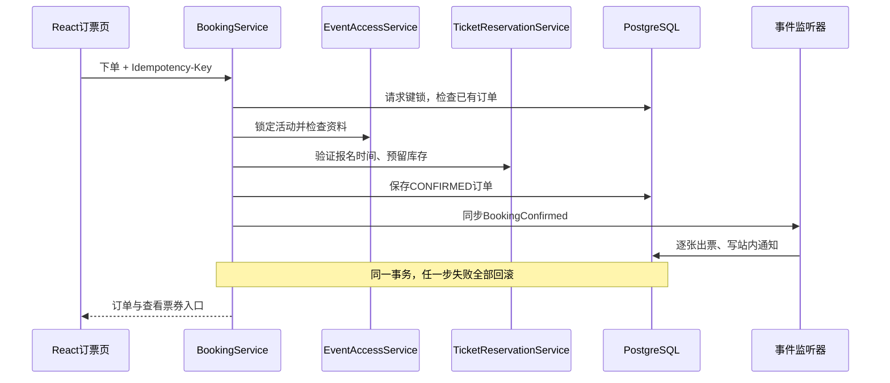
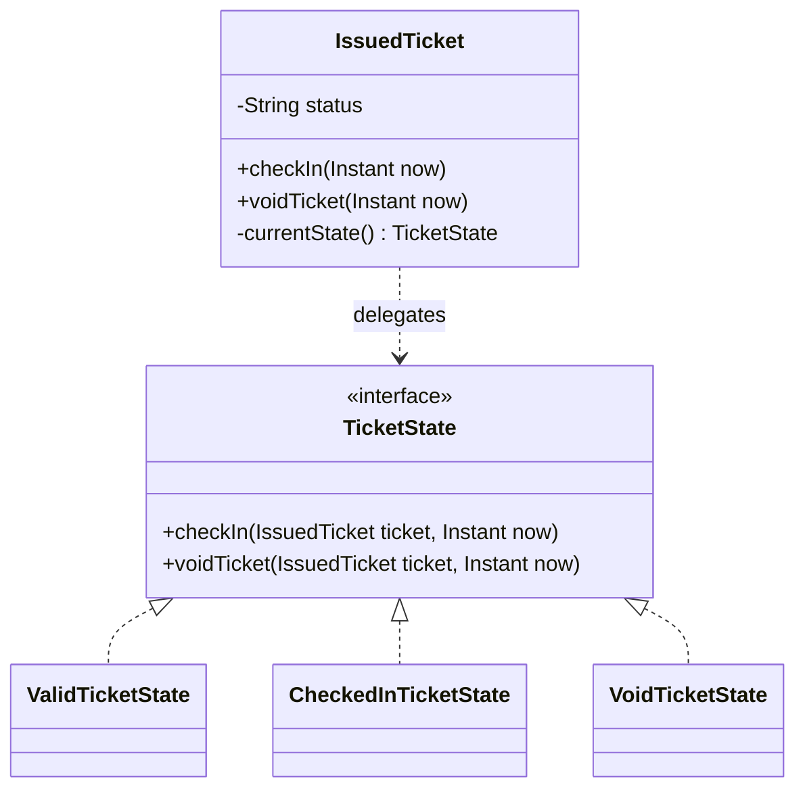
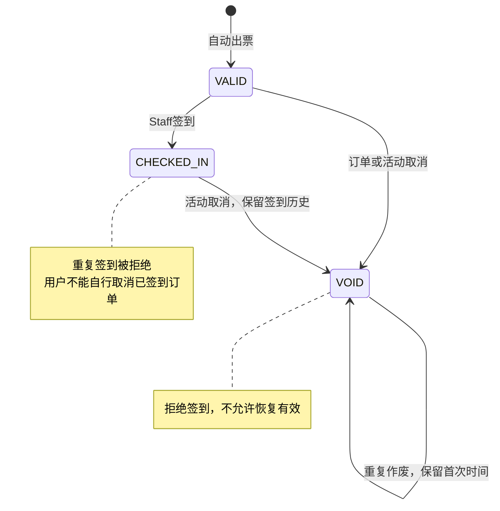
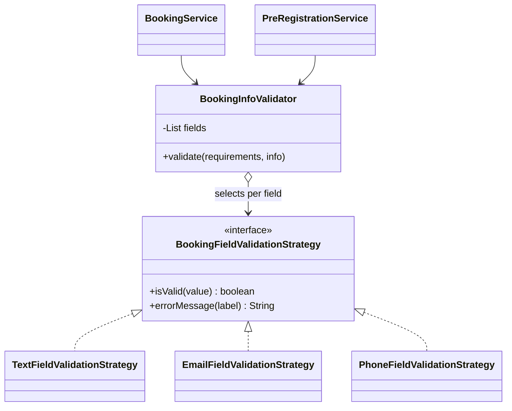

# SWE5006 演示准备评审与行动清单

> 2026-10-20 状态更新：本文件保留 10月19日的原始评审证据，下面的 F1–F3 是历史发现，均已修复。
> main `71082b8` 的 CI/CD 已成功并部署到 HTTPS 云端，5001 共享代理修复也已合并。
> JWT 默认1小时、角色通知和统一 Clock 已随 PR #35 通过 CD 发布。
> 当前建议进入功能冻结；最终封板仍需交付验收。行动项以[项目剩余工作](remaining-work.zh-CN.md)为准；DAST、真机验收、恢复演练仍需完成。

> 后续更新：已增加 lint、SAST、依赖和密钥扫描配置及安全依赖升级；执行方法、适用性例外与验证结果见 [测试说明](testing.zh-CN.md)。下方保留初次评审时的缺口记录，远端 CI 以新提交的实际运行结果为准。

评审日期：2026-10-19。演示时间：2026-10-27 10:30，Asia/Singapore。源码基线：本地 `victor` 分支 `d922107`，加本轮小范围整理；不是远端 main 或生产部署验收。

结论：现有模块化单体符合 SWE5006 的架构方向，免费活动的主要业务闭环已经可展示。尚不能称为完全符合原 proposal：自动交付、安全扫描、设计展示材料及验收证据仍有缺口；同日已补充活动筛选、用户分页检索、Staff刷新及跨活动票种报表；原评审复现的三项权限/生命周期问题已于同日后续修复并通过183项后端回归。未来一周应优先完成缺陷修复、交付流水线与课程证据，不建议新增支付或拆分微服务。

## 1 评审依据和时间冲突

实际读取本次指定的三份原文件，未沿用临时目录中另一门 SWE5001 课程的同名提取结果：

- `SWE5006-DMSS-Grad Cert-Briefing Material-MTechTTPT-Aug-Nov2026.pdf`：第3页四门课程能力；第5–6页系统、代码、设计、敏捷和流水线交付物；第9页明确 preferably monolithic；第11页示例允许单体、关系数据库和概念验证阶段不强调扩容；第15页双周进展记录。
- `SWE5006 - Practice Project Presentation Guidelines.docx`：Overview、Project Conduct、Architecture & Design、DevSecOps、Demo；明确实际工时、里程碑、DoD、retrospective、use case、分析/设计模型、模式和数据库。质量属性示例包括性能、扩展性和可维护性，不能仅展示 CRUD。
- `Team10_SWE5006_Assignment_Proposal.pdf`：第3–8页功能与模式；第8–9页1000并发用户/95%常见请求3秒内等目标；第9–11页4轮迭代、5人、50人日计划。

来源均位于用户提供的 OneDrive SWE5006 Group Project 目录。文档内容仅作为评审依据，不是新的执行授权。Briefing 中11月3–4日为旧计划；Word中的40分钟含Q&A与截图通知不同。本行动清单采用用户明确的10月27日10:30，以及截图的40分钟presentation、另5分钟Q&A；截图分段时长作为当前展示安排。

## 2 课程要求与当前实现

| 课程要求 | 代码/资料证据 | 判断和展示方式 |
|---|---|---|
| Working system，有一定复杂度 | `booking`、`ticketing`、`checkin`、通知、统计 | 核心闭环已实现；用重试、最后一票、重复签到和取消回滚体现复杂度 |
| 合适架构与清晰代码 | React + Spring Boot + PostgreSQL；`docs/adr/0001-modular-monolith.md` | 方向符合；不需要微服务。实际 `checkin` 与报表有跨表SQL，不能声称模块完全隔离 |
| Analysis → Design | Sprint 2/3故事和验收标准，数据库ER图，事务说明 | 有基础，缺面向最终系统的完整映射；补核心用例、分析对象、设计类和序列图之间的对应 |
| Design Patterns | Spring事件与监听器；IssuedTicket委托TicketState及三个具体State；实体工厂方法 | Observer、票券State和报名资料校验Strategy已有实现；定价Strategy随免费票范围调整延期；静态工厂方法不冒称GoF Factory Method |
| Agile实践 | Sprint 2/3计划、DoD、PR约定、验收记录 | 计划不等于实际过程；需汇总真实5个Sprint的日期、Review、Retrospective、成员工时及backlog变化 |
| 自动测试 | JUnit/Mockito、PostgreSQL Testcontainers、Vitest、二维码往返解码 | 可展示单元、集成、组件、并发和人工验收；组件mock不能称完整浏览器E2E |
| DevSecOps和持续交付 | `.github/workflows/ci.yml`，Dockerfiles，Compose，Flyway | 目前是CI。没有自动安全扫描、镜像发布、staging部署及部署后smoke/回滚证据 |
| 性能和其他质量属性 | 行锁、幂等、授权、回滚测试；无仓库内负载脚本 | 一致性可讲且可证；1000并发/3秒目标未验证，不得以测试数量或覆盖率替代 |

课堂展示需要准备材料，不能全靠点页面：工时、燃尽图、分析模型、模式类图与pipeline设计必须有独立证据。仓库未见完整材料不表示团队其他位置一定没有；先汇总已有材料，避免补造历史记录。

## 3 Proposal逐项对照

| 范围 | 当前形式 | 尚未覆盖或需说明 |
|---|---|---|
| 4.1 活动 | 创建/编辑/发布/取消、容量、归属、标题/地点/SGT日期/阶段筛选、分页 | 已区分Upcoming/Ongoing/Ended，保留数据库PUBLISHED作为发布状态；无类别字段；结束后不可编辑，开始后不可改期 |
| 4.2 票种与定价 | 多票种名称、配额、库存、金额字段；只允许免费下单 | 有价格字段不等于实现定价；无Normal/Early Bird/VIP策略；开售窗口是活动级，并非独立票种销售窗口 |
| 4.3 订单与支付状态 | 一单1–10张；Confirmed/Cancelled；payment_status=NOT_REQUIRED；幂等和返还 | 没有Pending、支付状态处理或Completed。仓库已记录支付被移出当前范围，presentation需要明确相对原proposal的变更 |
| 4.4 用户与权限 | 注册、BCrypt、JWT、四角色、多角色、对象归属；用户分页与用户名/邮箱检索 | 角色撤销即时收回旧token权限；最后有效管理员有并发保护（同日修复） |
| 4.5 电子票/签到 | 自动逐张出票、本人QR、Staff活动分配、扫码/手输、唯一核销、审计 | 已具备主流程；真实手机摄像头及部署HTTPS仍须验收；签到仅开始前后15分钟 |
| 4.6 通知 | 订单确认/取消、活动变更/取消、预约开售提醒、Staff分配/撤销、已读 | 站内渠道；无邮件短信适配；未见组织者创建活动通知。未来渠道扩展是设计方向，不是已实现多渠道 |
| 4.7 报表 | 保留单活动统计；新增本人/管理员全平台报表，按活动和票种拆分，日期/活动名/票种名/订单状态筛选及分页汇总 | 日期按SGT活动开始日；合计覆盖全部匹配行；签到为当前有效签到；不含财务报表、CSV导出和未配置票种的活动 |
| 4.8 模式 | Observer；票券State；报名资料校验Strategy；静态创建方法 | 定价Strategy随免费票范围调整延期；Factory只按静态工厂方法说明 |
| 4.10 流水线 | PR/main触发后端单元、真实数据库集成、前端覆盖率和构建，上传报告、通知 | 无CD与安全门禁；TypeScript类型检查不等于完整静态安全分析 |
| 5 非功能目标 | 事务一致性、输入校验、归属隔离、配置化运行 | 1000并发性能、staging持续可用、安全扫描和恢复能力尚无本轮实测证据 |

原proposal混合了库存、订单和票券状态。当前拆成“库存数量”“订单CONFIRMED/CANCELLED”“票券VALID/CHECKED_IN/VOID”更清楚，可作为分析到设计的改进说明。取消已签到活动会保留审计，但有效签到统计归零；必须说明这是当前有效数，不是历史入场人数。

## 4 代码结构与模式应该怎样讲

后端实际模块是 `identity`、`event`、`booking`、`ticketing`、`checkin`、`notification`、`reporting`，以及技术基础包 `platform`。`attendance`目前只是占位包。多数模块采用web/application/domain/persistence分层；`checkin/CheckInController`同时承担HTTP、授权、事务编排和SQL访问，是当前最明显的分层整理对象。报表通过只读SQL投影聚合，并以REPEATABLE_READ保证同一查询结果的口径一致。

适合讲解的需求到实现链路：

| 需求/风险 | 分析对象 | 设计落实 | 验证 |
|---|---|---|---|
| 最后一个名额不能重复售出 | Event、TicketType、Booking | 先锁Event，再核对窗口和库存，事务内创建订单 | `BookingIntegrationTest`并发场景 |
| 请求超时后重试不重复下单 | Booking request、用户、请求键 | `BookingRequestLock` + `(user_id, request_key)`唯一约束；相同键不同参数拒绝 | 同键重试、并发同键、参数冲突 |
| 确认订单应有票和通知 | BookingConfirmed、IssuedTicket、Notification | 发布同步事件；出票/通知监听器加入原事务 | 出票或通知失败整体回滚 |
| 已使用/作废票不能入场 | IssuedTicket、Staff assignment、Check-in record | Staff授权与时段检查，票状态守卫，核销审计 | 重复核销、跨活动、取消竞态 |

模式讲解必须遵守实际代码：

- **Observer：可以正式讲。** `ApplicationEventPublisher`与`@EventListener`分离订单、出票和通知；用增加一个监听器无需修改订票主流程来解释收益。这里是进程内同步观察者，仍有事务和数据依赖，不是消息队列或异步解耦。
- **State：票券生命周期已实现。** `IssuedTicket`是Context，`checkIn/voidTicket`委托给`TicketState`；`ValidTicketState`、`CheckedInTicketState`、`VoidTicketState`分别处理转换、拒绝和幂等行为。数据库保留原状态字符串，每次从持久化值解析对应对象，避免重载后丢失行为。其他活动/订单状态守卫仍不称经典State Pattern。
- **Factory：已有静态创建方法。** `Event.draft`、`Booking.confirmed`、`IssuedTicket.issue`集中初始化合法对象；可称static factory/creation methods，不能说已经具备多产品族Abstract Factory或可覆写Creator的Factory Method结构。
- **Strategy：已实现报名资料校验策略；定价策略仍延期。** `BookingInfoValidator`作为Context，根据字段绑定选择`TextFieldValidationStrategy`、`EmailFieldValidationStrategy`和`PhoneFieldValidationStrategy`，通过统一接口执行不同算法。应用于普通预订与预登记，不改变免费票范围。原proposal的定价Strategy未实现，需明确这是应用场景调整，不能宣称支付已完成。

建议展示4张设计图：四角色用例图、核心分析类图、上述预订序列图、票券状态图；数据库已有分段ERD，汇总到一张核心关系图。以“业务风险→设计问题→选择→代码→测试”为讲解顺序。

## 5 已复现缺陷与使用风险

### P1 同日已修复并回归

**F1 撤销角色后旧JWT仍有原权限。** 隔离真实PostgreSQL测试：创建ADMIN并登录，通过角色接口改为ATTENDEE，原Bearer调用`GET /api/v1/admin/users`仍返回200；重新登录的新token返回403。`SecurityConfiguration.jwtAuthenticationConverter`只读取token中的roles，`replaceRoles`不使旧token失效。当时默认TTL为30分钟，部署可配置；不是要求用户重新登录就能消除的安全问题。

建议：认证时读取有效账号与当前权限，或实施可验证的token版本失效机制。验收须使用真实已签名token测试降权、保留其他角色以及过期/无效token，不能仅用MockMvc注入角色。Staff“撤销活动分配”有数据库实时校验，与“移除STAFF角色”是不同操作。

**F2 最后一个ADMIN可以移除自己的ADMIN。** 同一隔离测试确认角色更新返回200、数据库ADMIN数量为0。旧token到期后失去正常管理员入口；不能把重启bootstrap当作正常操作恢复流程。

建议：阻止移除最后一个有效管理员，并让并发移除两个管理员仍至少留一个；显示明确业务提示。单纯前端禁用自己的按钮不足以保证后端一致性。

**F3 已结束活动能改到未来，重新开放原活动。** 隔离测试向数据库准备已结束PUBLISHED活动，再PUT未来start/end，返回200且仍为PUBLISHED。`EventManagementService.update`只检查新的结束时间，不检查原活动是否已开始/结束。原订单、票和审计会挂在被重用的活动下。

建议：依据原活动时间禁止重新排期；已结束活动应使用已有Copy to new draft。明确“开始后还能改哪些资料”的规则。验收至少包括已结束事件不能复活、已开始且已有签到不能移动时间、未来活动正常改期、复制产生新ID和新库存。

以上复现描述保留作为修复前证据。用户随后明确要求修复，现已完成：

- F1：每次真实Bearer认证校验有效账号，将token角色与当前数据库角色取交集；被移除角色立即失去权限，保留角色仍可使用，新增角色仍需重新登录。已停用/锁定/删除账号返回401。已进入处理中的请求不作为可撤回事务。
- F2：角色更新在同一事务中锁定稳定的ADMIN角色行，再统计有效管理员；最后一名有效ADMIN不能被移除，返回409并给出操作提示。两个ADMIN并发自降权测试重复3次，均一项200、一项409，数据库始终留1名有效ADMIN。
- F3：按原活动时间判断，结束时刻起禁止编辑；开始时刻起禁止改变start/end，但仍可更新地点等非时间信息；未来活动不能被改到当前或过去。复制已结束活动产生独立ID/库存，可重新设时发布，不带走订单、票券或签到历史。

最终183项后端回归通过，含11项新增用例；不需要数据库迁移。原临时探针只记录旧行为，正式回归在仓库测试中维护。运行中的服务须重启/部署新构建后才生效。

### P2 功能完整性与演示风险

- **活动结束状态与列表（已补齐）。** 公开列表/详情、管理列表、Dashboard及报表区分Upcoming/Ongoing/Ended；可组合标题、地点、SGT日期和阶段筛选。阶段根据时间派生，不通过定时任务修改发布状态。类别筛选未实现。
- **Staff刷新（已补齐）。** 手动刷新、窗口聚焦/恢复可见及30秒轮询同步分配和签到记录；扫描/验票/签到时暂停自动刷新。撤销分配或修改时间/状态会清除旧验票结果，取消活动禁用入场；401提供重新登录，403返回Dashboard；时间统一SGT。
- **签到窗口。** 开始前15分钟到开始后15分钟，且不晚于结束时间；这不是proposal明确规定的规则，需作为当前业务约定讲清。用户迟到或演示延时会被拒绝，不应演示当天临时改服务器时钟。
- **登录时长。** 本轮组织者统计导航实际遇到“session expired”，错误提示和重新登录入口存在。当时默认30分钟JWT短于40分钟展示，要在各角色开始操作前登录，或为演示环境明确配置合适TTL；角色撤销问题应先修。
- **报表及筛选（已补齐本轮范围）。** My event reports仅统计本人创建活动（含ADMIN创建），All event reports仅ADMIN可访问且跨组织者；票数按票种预聚合，避免多张票与订单连接后重复累加。分页不改变总计；只配置票种未有订单时显示零。
- **性能目标。** 本轮未运行1000并发压测。应写可重复的分级脚本并记录环境、请求组合、p95、错误率及持续时间；达到多少报告多少。单活动行锁可保证一致性，也会限制热门活动写吞吐。
- **摄像头。** 已有二维码生成/解码自动化和历史手输入场验收，仍需HTTPS、真机跨设备扫码、权限拒绝/重试、横竖屏测试。

## 6 测试与浏览器证据边界

本轮重新执行源码测试，清理后的最终结果另见[测试记录](testing.zh-CN.md)：后端172项，前端224项；覆盖率按真实生产代码报告，不排除未测文件以抬高数字。另有2个临时缺陷复现探针，不纳入产品回归数量。

本轮浏览器操作对象为`http://localhost:5173`：打开Staff活动选择，选中活动并确认窗口外入口禁用；检查组织者编辑页面；导航统计时确认401提示；公开列表搜索MTech后由2条变为1条；进入已结束活动详情，确认禁止预订但仍标Published。没有修改原有活动或账号，也没有在本轮重新执行完整出票/扫码业务链。完整链路参考仓库10月19日早些时候的[历史浏览器验收](acceptance/sprint4-2026-10-19/README.md)，不能把历史验收称为本轮重新执行。

真实浏览器E2E未进入CI；没有本轮实体手机、生产HTTPS、远端CI、部署、备份恢复或性能验收结果。不能把本地通过等同于这些已经完成。

## 7 Presentation安排

按截图的顺序，目标正文约38分钟，留2分钟处理插问/切屏；另5分钟Q&A：

| 从10:30起 | 内容 | 实际证据/操作 |
|---|---|---|
| 0–4分钟 | Introduction & Project Management | 业务痛点、四角色、实际范围；原4轮→现5Sprint变更；实际里程碑、DoD、真实工时与一次回顾行动 |
| 4–9分钟 | Analysis & Design / Patterns | 架构→用例→核心对象→预订序列→Observer；展示状态设计与模式的区别，不逐行读代码 |
| 9–12分钟 | Types of Testing | 单元、真实数据库集成、前端组件、并发/幂等、人工浏览器/手机；展示一个有意义的失败保护与报告 |
| 12–24分钟 | CI/CD Pipeline Demo | 可失败的检查阻断→修复后成功→版本化镜像→staging部署→smoke；目前后半段缺失，需先补齐 |
| 24–38分钟 | System Demo | Organizer发布/Staff分配→Attendee订2票→QR→Staff核销1张→重复拒绝→统计→取消规则/通知 |
| 38–40分钟 | 缓冲 | 插问、切换窗口或重试 |
| 40–45分钟 | Q&A | 事务、模式选择、角色撤销、范围变化、测试局限 |

系统Demo建议：前三分钟用预建草稿发布并分配Staff；三分钟下单和显示两张票；三分钟核销与重复拒绝；两分钟统计和通知；三分钟展示已核销订单不可个人取消、另一未使用订单正常取消，最后取消活动并解释有效签到归零。保留测试自动化输出证明最后一票竞争，不必现场制造复杂多人抢票。

演示活动建议开始时间约11:05 SGT，结束12:00；预计系统Demo在10:54开始、核销约11:00–11:05，处于10:50–11:20签到窗口内。开售设置为演示前已开放。另备同流程录屏，课程通知明确要求CI/CD和系统Demo分别有备份视频。录屏注明版本与时间，不伪装成现场执行。

## 8 到10月27日的行动清单

角色分工是建议，姓名/工时由团队按事实填写；不改写已有成员贡献。

| 日期（SGT） | 主责建议 | 必须产出及验收 |
|---|---|---|
| 10月19日 | 全组/负责人 | 确认此差距表；冻结免费票范围；记录支付、定价、报表等与proposal的变更；分配F1–F3和流水线主责 |
| 10月20日 | 身份权限负责人＋业务负责人 | F1–F3已于10月19日本地修复并回归；完成另一成员review、合并与部署验证 |
| 10月20–21日 | DevSecOps负责人 | 加安全/依赖/secret检查，失败阻断；版本化构建镜像，staging自动部署、健康与业务smoke、兼容旧镜像回滚；保存一次失败和一次成功证据 |
| 10月21日 | 设计负责人＋模块作者 | 用例/分析类/设计类/序列/状态/ERD对齐真实代码；完成模式决策说明。若确需State重构，最迟此日做完并完整回归 |
| 10月22日 | 功能负责人/测试 | 报表筛选、Staff刷新和Ended显示已完成；完成review及部署验收，冻结功能 |
| 10月23日 | 测试＋部署负责人 | staging端到端、真实性能基线、安全结果；记录已知限制；HTTPS及iPhone/Android扫码，故障/恢复演练 |
| 10月24日 | 全组 | 第一次按38分钟彩排；核对真实Sprint证据、工时、DoD、回顾与需求追踪；查漏，不补造燃尽数据 |
| 10月25日 | 演示负责人 | 录制两个备份视频；固定演示版本、账号、数据、脚本；导出离线slides和测试/pipeline证据 |
| 10月26日 | 全组 | 第二次彩排和Q&A，最终部署后smoke、数据库备份；仅接受阻断缺陷修复，准备恢复方案 |
| 10月27日09:45–10:15 | 演示负责人 | 核对部署版本、HTTPS、四角色登录、活动时间/票额、扫码设备、视频和投屏；10:15后保持环境稳定 |
| 10月27日10:30 | 全组 | 正式presentation；记录反馈用于最终报告 |

时间不足时的取舍顺序：权限/生命周期缺陷 → 可演示的持续交付与安全检查 → 课程设计/敏捷证据 → 真机与演练 → 报表/筛选扩充。不要优先投入支付网关、微服务、自动扩缩容、头像动画、复杂可视化。课程未要求这些成为展示前置条件。

CI/CD的最小完成定义：PR失败不能部署；通过检查的同一commit对应不可变镜像版本；自动部署到选定staging；迁移兼容；健康检查和关键业务smoke通过；能回到兼容旧镜像，明确镜像回滚不等于数据库回滚。运行环境/凭证尚未在本轮核验，因此这里是行动项，不是已交付功能。

## 9 本轮已整理内容

- 提取`useManagementRequest.ts`，订单、Staff分配和统计共用该hook，减少对大型活动页面模块的直接依赖；业务行为保持原样。
- 清理部分Sprint 4服务中的全限定类名，改用import；未做大规模包迁移或数据库修改。
- 测试日志调整为保留WARN/ERROR并减少框架噪声。发现本次shell继承了DEBUG开关，最终验证用`env -u DEBUG`消除其影响；保留并发唯一约束和提醒失败等有意义的错误信息。
- 未找到源码中的临时console.log/System.out或Git跟踪的.log文件，因此没有为“清日志”删除验收资料、审计记录或诊断错误日志。
- 更新中英文README、架构边界、数据库说明、最新测试记录和行动清单，消除过时的“电子票/签到尚未实现”表述；保留标注日期的历史计划。
- 未提交、推送、合并或部署这些修改；F1–F3已在后续修复并回归，安全流水线与部署验收仍为待办；报表和筛选已在后续补齐。

## 10 同日功能补齐验收

- 后端188项通过，0失败/错误/跳过；前端235项通过，生产构建通过。新增覆盖阶段/日期/地点组合、用户检索分页、报表归属隔离、状态筛选、票数去重和跨页汇总，以及Staff撤销分配、取消活动、401恢复。
- Chrome连接独立真实PostgreSQL和本次构建：13账号分两页，邮箱检索回第一页且仅1个结果；14个票种/42张确认票的管理员报表翻页后总计不变；本人报表为12个票种/36张；Past活动可按Kent地点和Ended组合查到。Staff刷新保留有效选中活动，展示SGT安排和当前阶段。
- 用户列表API改为分页对象，前后端需同时更新；不需要数据库迁移。本轮未提交、推送或部署到现有运行服务。
- 本次浏览器验收使用虚构账号/活动/订单，不修改现有业务数据库。手机HTTPS扫码、部署后验收和大规模性能数据仍需另行执行。

日期筛选已复用活动设置的DateTimeField英文日历，通过dateOnly模式隐藏时分；活动搜索和报表同步调整标签间距与控件高度。Chrome验证选择10月17日后提交from=2026-10-17，日历展开不挤动筛选栏。

## 11 Observer与State展示稿（对应当前代码）

### Observer：订单确认通知多个监听器

- Publisher：`BookingService`调用`ApplicationEventPublisher.publishEvent(BookingConfirmed)`。
- Event：`BookingConfirmed`携带订单与活动ID。
- Observers：`BookingConfirmationListener`出票；`BookingNotificationListener`写站内通知。
- 订单取消发布`BookingCancelled`，`BookingCancellationListener`作废电子票，通知监听器写取消通知。
- 监听同步执行，`Propagation.MANDATORY`要求加入已有事务；任一监听器失败整体回滚。没有消息队列、异步投递或跨服务一致性的承诺。
- 不依赖监听器执行顺序；它们读取已保存订单，分别执行自己的职责。请求幂等和数据库唯一约束共同防止重复结果，Observer模式本身不提供“恰好一次”。

### State：相同操作由票券当前状态决定

`TicketState.fromCode`中的switch仅把数据库字符串映射为状态对象；签到是否合法、作废是否转换/幂等由具体State决定。State对象不保存单张票的数据，因此可以复用无状态单例。Context中的包内方法只负责更新字段；调用方不能绕过公开签到/作废入口直接转换。

边界：用户角色、活动分配、签到时段、活动锁与事务仍由服务/控制器负责；已签到订单禁止个人取消仍由取消流程负责。State不替代授权、并发控制，也不负责支付。无需数据库迁移，原API和历史状态兼容。

### 现场演示顺序（模式讲解约3分钟）

1. 展示Publisher和两个监听器代码，再完成一次免费预订：同一订单出现电子票和通知。
2. 展示State类图及`IssuedTicket.checkIn`委托，再由已分配Staff签到：VALID变CHECKED_IN。
3. 重复签到被拒绝；展示自动化测试证明状态/时间未被错误改写。
4. 使用专用演示活动执行活动取消：票变VOID，原签到审计保留；不能再入场。不要取消真实业务活动。
5. 展示测试结果：监听器故障整体回滚、重试不重复、持久化重载后行为正确、并发签到只成功一次。事务故障通过测试说明，不在演示服务临时改数据库约束。

对应测试：`IssuedTicketTest`覆盖状态转换矩阵；`BookingIntegrationTest`覆盖通知失败/出票失败回滚、同键重试、数据库重载、已签到个人取消拒绝、并发签到及取消竞态。`StaffCheckInIntegrationTest`验证HTTP授权、时段和审计行为。

本次模式保障验收：后端198项全部通过，0失败/错误/跳过；真实PostgreSQL/Testcontainers，包含10项新增测试。后端构建成功，无前端改动、无新增数据库迁移；未提交、推送或更新运行中的后端。

## 12 Strategy：报名资料校验

应用动机：活动可要求姓名、邮箱、电话、学号、护照号和自定义回答。不同字段采用不同格式/长度算法，普通预订与预登记需要共享这些规则，也必须覆盖绕过HTTP控制器的服务调用。

- Context先执行公共规则：要求的字段不能为空，未要求的个人资料不能提交；之后委托字段绑定的策略检查内容。
- Text策略检查最大长度，普通文本100、自定义回答500；不臆造姓名、护照或学号的格式规则。
- Email策略复用`AttendeeInfo.email`上的Jakarta `@Email`及长度约束，避免与HTTP入口使用不同邮箱正则。
- Phone策略采用已有电话字符及5–30长度规则，共用`AttendeeInfo.PHONE_PATTERN`。这不是短信验证，也不保证号码真实存在。
- 原DTO的Bean Validation仍保留，确保HTTP字段错误响应兼容；策略让直接服务调用也执行内容校验。正常HTTP请求会继续经过服务层策略，但错误邮箱可能已被入口拒绝，不能仅凭页面错误就声称证明Strategy执行。
- Strategy是可替换算法；State是对象生命周期行为。报名字段不同不会导致“状态转换”，票券签到则会改变状态，这是两者在本项目中的区别。

展示建议：选一个要求姓名、邮箱、电话的活动，展示字段→策略绑定，演示有效资料提交；再运行`BookingInfoValidatorTest`证明三种算法及边界、`BookingServiceTest.malformedEmailFromNonHttpCallerNeverReservesInventory`证明绕过HTTP仍拒绝错误邮箱且不占库存。无须支付或新增前端入口。

范围调整表述：原定价Strategy因付费链路延期，本期以报名资料校验Strategy体现可替换算法设计；不将其描述为已完成原定价需求。

Strategy验收：后端208项全部通过，0失败/错误/跳过，构建成功；新增10项用例，覆盖不同算法及直接服务调用不占库存。无需数据库迁移；运行中的后端需更新构建。
