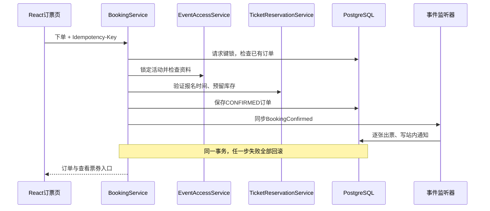
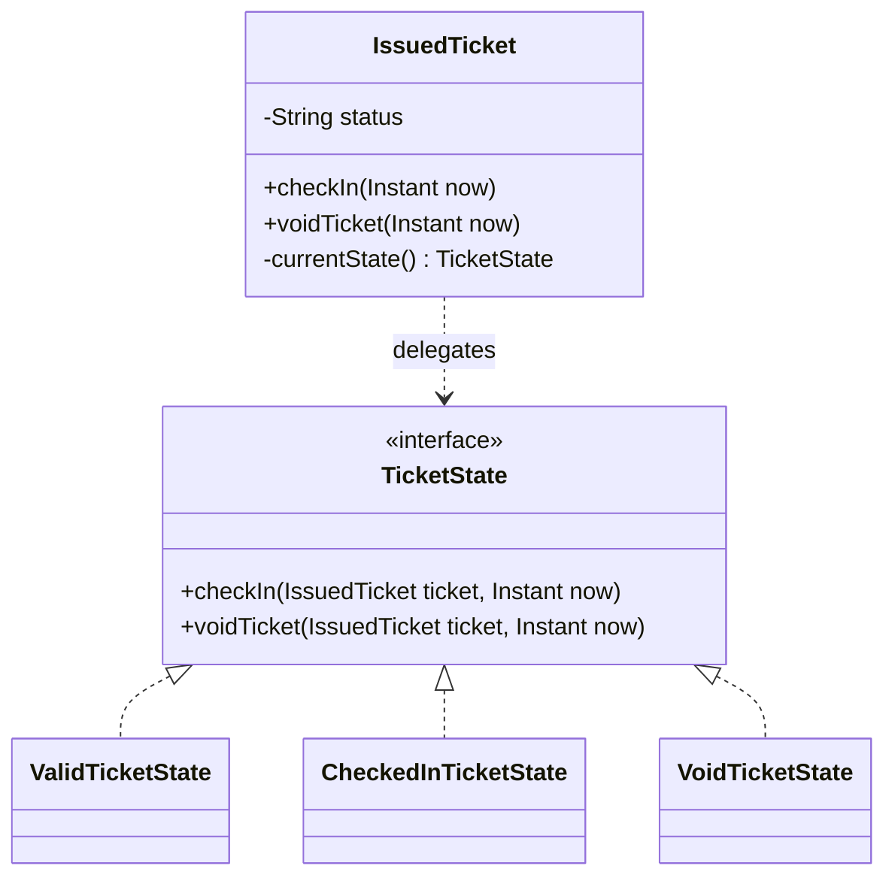
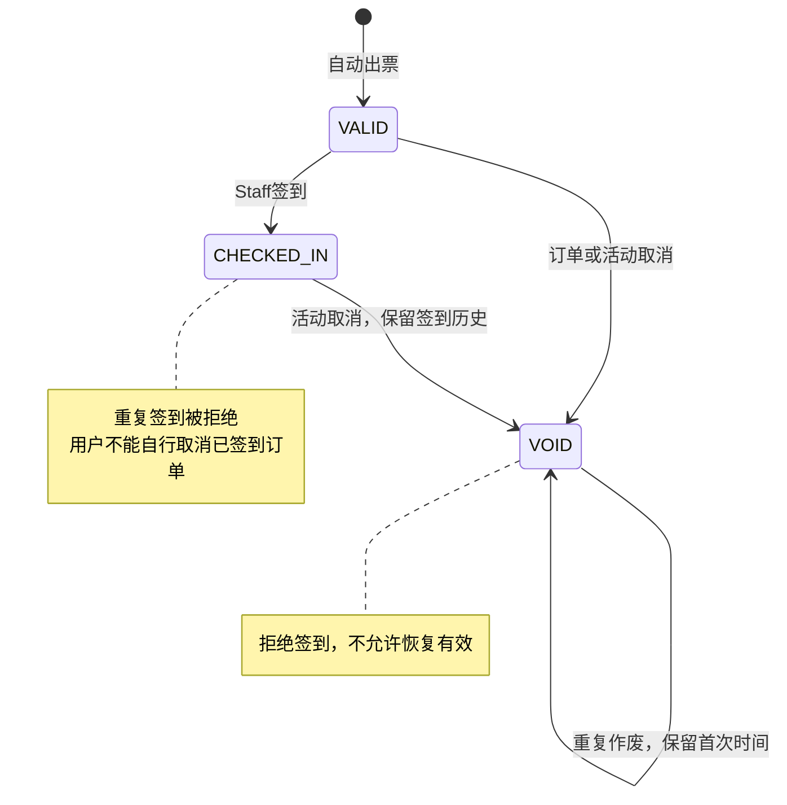
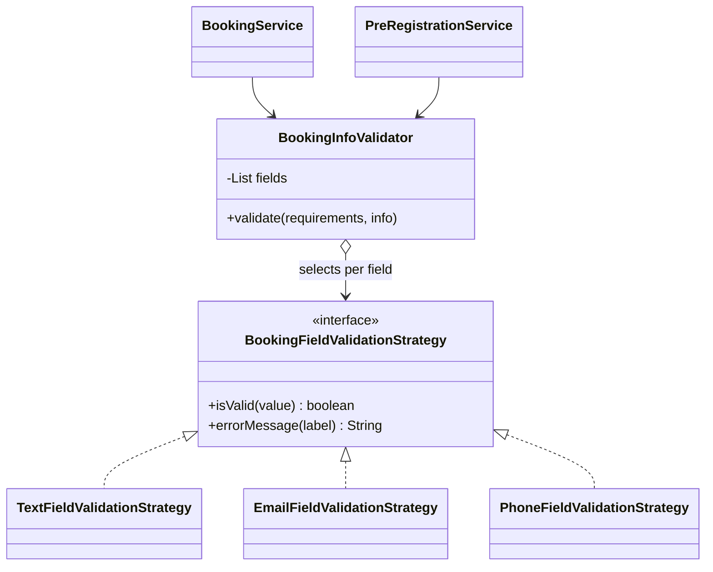

# Presentation准备与设计讲解

**本组正式演示已由维护者确认：2026年10月27日10:30 SGT；按教师通知展示40分钟，之后另5分钟Q&A。** 公告截图标题`Project Presentation Guidelines - 26, 27 Nov 2026`中的11月日期不用于本组排期，保留为来源标识。当前业务范围为免费票，应用已功能冻结。完成状态和日期只维护在[交付清单](remaining-work.zh-CN.md)，此文负责原文要求映射、讲解与材料结构。Final report完整编写按维护者要求放在pre后。

## 2026年10月21日原文核对

已阅读维护者提供的四份原文件，并补充核对本轮教师公告截图。**教师公告与通用Word指南的时长不同，当前按教师公告执行**；上一轮仅按Word指南将45分钟安排判为超时的结论已撤回。以下区分课程要求、历史团队材料和准备建议；报告写作要求不自动转化为pre前必须补齐整份报告的任务。

| 来源 | 原文要求及本次用途 |
|---|---|
| 教师公告截图：`Project Presentation Guidelines - 26, 27 Nov 2026` | 当前执行依据：40分钟展示后另5分钟Q&A；教师也可能中途提问。顺序为Introduction/Management 3–4分钟、Analysis/Design/Patterns 5分钟、Testing 3分钟、CI/CD Demo 10–12分钟、System Demo 12–15分钟；两段Demo分别提前录制备用视频。截图链接指向[Canvas指南目录](https://canvas.nus.edu.sg/courses/100094/files/folder/SWE5006%20-%20Practice%20Project%20Presentation%20Guidelines)，本次依据截图核对，未将链接目录视为分组时间表 |
| `SWE5006 - Practice Project Presentation Guidelines.docx` | 通用指南原建议为40分钟含Q&A，与公告不同，时长/顺序现由公告替代；继续用于内容核对：实际里程碑/个人投入、DoD、Retro到下轮改进、分析到设计、模式、数据库及重要质量属性 |
| `SWE5006-DMSS-Grad Cert-Briefing Material-MTechTTPT-Aug-Nov2026.pdf` | 第5–6页列working system、代码、管线/测试脚本、slides、敏捷产物、分析设计、模式和DevSecOps设计；第7页11月3–4日pre、11月10日报告为早期暂定排期。本组pre按维护者确认的10月27日10:30；报告截止仍以最新课程要求为准 |
| `SWE5006 - Project Report Template for Practice Module.docx` | 详细报告结构，包括每位成员至少一个用例及一个设计问题、分析/设计类图与主要流程序列、模式方案与实施决策。pre先提炼必要设计说明；全量逐人图文、章节和个人贡献汇总在pre后补齐 |
| `Materials_for_Final_Report_Consolidated_20261012.docx` | 团队10月12日、代码`ce5d860`的历史素材，包含五人分工与C/D系列图，不是现版本验收。可取材，不能原样复制“票券/核销/通知/报表未实现”“即时撤权未实现”“State/Strategy仅候选”等旧结论；旧稿的after-commit通知建议也不代表当前实现，现站内通知与业务同事务 |

**核对结论：系统已有支持pre的业务、设计模式、测试、流水线及性能证据；完整pre准备尚未完成。** 本次为原文、源码和已有验收的核对，没有重新执行云端压力测试或全套业务验收。当前主要缺口在slides、真实敏捷/贡献记录、分析到设计的展示，以及脚本化质量属性演示和40分钟内的编排。

| Pre要求 | 系统及现有证据 | 仍需准备的展示 |
|---|---|---|
| Working system / significant use cases | 发布→预订→逐张电子票→Staff授权/核销→统计→取消/通知闭环，已云端验收，系统Demo v3有真实操作 | 选择有业务复杂度的主线，保留重复核销、已用订单不能个人取消及取消后VOID/审计；准备现场活动窗口 |
| Architecture / analysis → design | 模块化单体、分层、公开服务/同步事件、事务与锁均有实现；完整核心ERD已更新 | 更新旧用例/架构图；选择预订或核销，将分析对象、分析交互、设计类/序列、具体代码及测试串成一条链，说明transition策略；披露checkin/reporting跨模块JDBC例外 |
| Design problems / patterns | 源码核对：Observer为`BookingConfirmed`及同步出票/通知监听器；State为`IssuedTicket`委托三个状态对象；Strategy为报名字段的三类校验算法 | 讲清具体问题、简单方案、选择理由、协作结构、行为与测试。旧资料的定价Strategy未实现，不能拿它替代当前资料校验Strategy；DI/Repository不额外计作GoF模式 |
| Testing / quality attributes | 后端215项功能测试、前端244项；权限/并发/回滚覆盖；500 VU目标通过、1000 VU仅读取通过；恢复及DAST证据已有 | 除结果数值外，展示性能脚本的模型/门槛和一次实际输出；用失败保护测试说明正确性。当前成片没有独立的脚本化性能测试环节，需加入讲解或备用短录屏 |
| DevSecOps / source and artifact management | PR检查、受测JAR/dist、镜像扫描/冒烟、digest发布、备份部署、HTTPS及DAST均有脚本与成功运行，另有真实历史失败 | 解释源码/分支/制品、环境和验证流程，展示真实问题及修正。11:09视频适合公告10–12分钟预算；以现场Demo为主，成片按技术故障时的备用路线准备 |
| Project Conduct / Agile | 保留Sprint计划、Git/PR及历史报告分工；它们不等同于实际过程记录 | 汇总实际Sprint日期、每人投入、backlog/user stories、DoD结果、Review、Retro及下轮改进行动；燃尽等图仅使用真实记录，缺失时如实说明，不能用估算或提交数补造 |
| Readable slides / time management | 设计文档和视频可复用 | Slides仍待制作；按40分钟展示加5分钟Q&A彩排，为中途提问留余量，避免整片播放与同内容现场操作重复占时 |

这四份文件未设统一的1000 VU、付费交易、微服务、Kubernetes或自动伸缩交付门槛。Guidelines把auto-scaling列为scalability展示的例子，不据此新增基础设施；可用已有性能、可维护性和事务正确性证据说明本系统的重要质量属性。团队proposal中原有的1000并发目标仍应如实说明调整与未全达标结果；团队500 VU验收决定不等于已获得教师对proposal变更的批准。

## 材料内容结构

此表说明slides及附录应包含的内容；完成状态和排期统一见[交付清单](remaining-work.zh-CN.md#剩余交付工作)。现有讲解和图示可复用，先汇总真实证据，不补造历史工时或燃尽数据。

| 材料 | 必须对应的内容 |
|---|---|
| 项目与范围 | 四角色、免费票闭环、proposal范围变更及实际里程碑 |
| Analysis → Design | 四角色用例图、核心分析对象、设计类、预订序列、票券状态与核心ERD的对应 |
| 模式决策 | Observer、State、报名资料校验Strategy的动机、代码、测试及边界 |
| 敏捷过程 | 五个Sprint的真实日期、backlog变更、DoD、Review/Retrospective、成员实际工时及行动项 |
| 测试与质量属性 | 最新测试/覆盖率、授权与并发保护、云端验收、性能基线、恢复验证及适用范围 |
| DevSecOps | PR检查→受测镜像→digest发布→数据库备份→部署→HTTPS检查→DAST；保存一次历史失败与成功记录 |
| Demo与备份 | 多角色操作脚本、专用演示账号/活动、两份独立备份录屏（CI/CD与系统Demo） |

取材入口：业务规则与范围见[中文README](../README.zh-CN.md)，完整核心ERD见[数据库文档](database/README.md#current-core-erd)，最新CI/测试和历史覆盖率基线见[测试说明](testing.zh-CN.md)。当前仓库已有下列序列图及模式类图/状态图；新提供的consolidated材料还有历史用例/分析/设计图。Pre需更新状态与类名、补齐代表性分析到设计映射及slides排版，不能把旧图或讲解文档等同于现版本成品slides。

本次课程要求按上述原文重新核对。Proposal信息沿用2026-10-19评审的`Team10_SWE5006_Assignment_Proposal.pdf`记录，本次未重读该文件：原proposal为4轮迭代/50人日，并提出1000并发、95%常见请求3秒内目标；团队目前按五个Sprint交付，需说明范围与排期调整。本轮采用维护者确认的500 VU目标，已完成；1000 VU额外探索中读取通过、混合与库存未全部达标。保留原proposal，slides明确说明调整、实际负载模型与[最新实测限制](acceptance/capacity-2026-10-21/README.md)，不宣称兑现原1000并发全场景目标。

## 需求与实现映射

| 要求 | 已实现证据 | 展示边界 |
|---|---|---|
| 有复杂度的工作系统 | 订单幂等、库存行锁、出票/通知事务、核销审计和取消联动 | 展示重复请求及失败保护，不能只演示CRUD |
| 模块化单体 | React、一个Spring Boot后端、PostgreSQL；[ADR](adr/0001-modular-monolith.md) | checkin与reporting有跨模块JDBC查询，不声称所有边界完全隔离 |
| 角色与归属 | 当前角色与JWT角色取交集；最后有效管理员并发保护；Staff还需活动分配 | 新权限需重新登录；ADMIN管理活动仍按本人归属 |
| 活动、票与报表 | 发布/取消、活动筛选、票种配额、电子票、有效签到与票种汇总 | 有效签到不是历史入场总量；活动取消后审计保留、有效计数归零 |
| 通知 | 订单、活动、开售提醒、Staff分配及角色变更的站内通知 | 不宣称邮件、短信、WebSocket或自动抢票 |
| 模式 | Observer、State、资料校验Strategy | 定价Strategy随支付延期；静态创建方法不冒称GoF Factory Method |
| 交付与安全 | main自动部署、镜像扫描、备份、公开HTTPS DAST | DAST为未登录被动基线；恢复需人工执行，没有自动回滚 |

适合讲解的需求到实现链路：

| 需求/风险 | 分析对象 | 设计落实 | 验证 |
|---|---|---|---|
| 最后一个名额不能重复售出 | Event、TicketType、Booking | 先锁Event，再核对窗口和库存，事务内创建订单 | `BookingIntegrationTest`并发场景 |
| 请求超时后重试不重复下单 | Booking request、用户、请求键 | `BookingRequestLock` + `(user_id, request_key)`唯一约束；相同键不同参数拒绝 | 同键重试、并发同键、参数冲突 |
| 确认订单应有票和通知 | BookingConfirmed、IssuedTicket、Notification | 发布同步事件；出票/通知监听器加入原事务 | 出票或通知失败整体回滚 |
| 已使用/作废票不能入场 | IssuedTicket、Staff assignment、Check-in record | Staff授权与时段检查，票状态守卫，核销审计 | 重复核销、跨活动、取消竞态 |

## Observer与State

### Observer：订单确认通知多个监听器

- Publisher：`BookingService`调用`ApplicationEventPublisher.publishEvent(BookingConfirmed)`。
- Event：`BookingConfirmed`携带订单与活动ID。
- Observers：`BookingConfirmationListener`出票；`BookingNotificationListener`写站内通知。
- 订单取消发布`BookingCancelled`，`BookingCancellationListener`作废电子票，通知监听器写取消通知。
- 监听同步执行，`Propagation.MANDATORY`要求加入已有事务；任一监听器失败整体回滚。没有消息队列、异步投递或跨服务一致性的承诺。
- 不依赖监听器执行顺序；它们读取已保存订单，分别执行自己的职责。请求幂等和数据库唯一约束共同防止重复结果，Observer模式本身不提供“恰好一次”。

### State：相同操作由票券当前状态决定

`TicketState.fromCode`中的switch仅把数据库字符串映射为状态对象；签到是否合法、作废是否转换/幂等由具体State决定。State对象不保存单张票的数据，因此可以复用无状态单例。Context中的包内方法只负责更新字段；调用方不能绕过公开签到/作废入口直接转换。

边界：用户角色、活动分配、签到时段、活动锁与事务仍由服务/控制器负责；已签到订单禁止个人取消仍由取消流程负责。State不替代授权、并发控制，也不负责支付。无需数据库迁移，原API和历史状态兼容。

### 现场演示顺序（模式讲解约3分钟）

1. 展示Publisher和两个监听器代码，再完成一次免费预订：同一订单出现电子票和通知。
2. 展示State类图及`IssuedTicket.checkIn`委托，再由已分配Staff签到：VALID变CHECKED_IN。
3. 重复签到被拒绝；展示自动化测试证明状态/时间未被错误改写。
4. 使用专用演示活动执行活动取消：票变VOID，原签到审计保留；不能再入场。不要取消真实业务活动。
5. 展示测试结果：监听器故障整体回滚、重试不重复、持久化重载后行为正确、并发签到只成功一次。事务故障通过测试说明，不在演示服务临时改数据库约束。

对应测试：`IssuedTicketTest`覆盖状态转换矩阵；`BookingIntegrationTest`覆盖通知失败/出票失败回滚、同键重试、数据库重载、已签到个人取消拒绝、并发签到及取消竞态。`StaffCheckInIntegrationTest`验证HTTP授权、时段和审计行为。

## Strategy：报名资料校验

应用动机：活动可要求姓名、邮箱、电话、学号、护照号和自定义回答。不同字段采用不同格式/长度算法，普通预订与预登记需要共享这些规则，也必须覆盖绕过HTTP控制器的服务调用。

- Context先执行公共规则：要求的字段不能为空，未要求的个人资料不能提交；之后委托字段绑定的策略检查内容。
- Text策略检查最大长度，普通文本100、自定义回答500；不臆造姓名、护照或学号的格式规则。
- Email策略复用`AttendeeInfo.email`上的Jakarta `@Email`及长度约束，避免与HTTP入口使用不同邮箱正则。
- Phone策略采用已有电话字符及5–30长度规则，共用`AttendeeInfo.PHONE_PATTERN`。这不是短信验证，也不保证号码真实存在。
- 原DTO的Bean Validation仍保留，确保HTTP字段错误响应兼容；策略让直接服务调用也执行内容校验。正常HTTP请求会继续经过服务层策略，但错误邮箱可能已被入口拒绝，不能仅凭页面错误就声称证明Strategy执行。
- Strategy是可替换算法；State是对象生命周期行为。报名字段不同不会导致“状态转换”，票券签到则会改变状态，这是两者在本项目中的区别。

展示建议：选一个要求姓名、邮箱、电话的活动，展示字段→策略绑定，演示有效资料提交；再运行`BookingInfoValidatorTest`证明三种算法及边界、`BookingServiceTest.malformedEmailFromNonHttpCallerNeverReservesInventory`证明绕过HTTP仍拒绝错误邮箱且不占库存。无须支付或新增前端入口。

范围调整表述：原定价Strategy因付费链路延期，本期以报名资料校验Strategy体现可替换算法设计；不将其描述为已完成原定价需求。

## 演示节奏

| 从正式开始起 | 内容与建议预算 | 建议证据 |
|---|---|---|
| 0–4分钟 | Introduction & Project Management：4分钟（公告3–4） | 业务问题、范围、五Sprint、实际里程碑/个人投入、DoD及Retro改进 |
| 4–9分钟 | Analysis & Design / Design Patterns：5分钟 | 架构决策、代表性分析→设计链路、模式问题及核心ERD |
| 9–12分钟 | Types of Testing Conducted：3分钟 | 单元/真实数据库集成/前端/云端/安全测试的区别，重要失败保护与覆盖率边界 |
| 12–24分钟 | CI/CD Pipeline Demo：12分钟（公告10–12） | 触发与源码/制品策略、真实失败/修正、受测镜像、备份部署、HTTPS及DAST |
| 24–38分钟 | System Demo：14分钟（公告12–15） | [业务脚本](sprint-4-demo.zh-CN.md)主线、失败保护、脚本化性能与真实结果/限制 |
| 38–40分钟 | 机动：2分钟（团队预留） | 中途提问、切屏、演示重试 |
| 40–45分钟 | Q&A：5分钟 | 事务、模式选择、权限、范围调整及性能限制 |

公告给出五段顺序及时间范围；上表将其具体编排为38分钟正文、2分钟机动，之后5分钟Q&A。教师可中途提问，回答后继续演示，计时人应按实际用时压缩重复说明；末尾5分钟Q&A仍单独保留。测试有独立3分钟环节，不再沿用Word指南的30分钟正文加10分钟分段Q&A安排。

按已确认10月27日10:30开始准备活动，建议活动当日11:05–12:00，签到窗口10:50–11:20 SGT，覆盖System Demo预计10:54–11:08。报名提前开放，各角色演示前重新登录；彩排用独立时间合适的活动，正式活动日期不得误设为11月。

### 视频与备用路线

本地入口为`presentation-recordings/2026-10-21/cicd/SEMS-CICD-Bilingual-EN-ZH-11m09s.mp4`和`presentation-recordings/2026-10-21/system-demo-v3/SEMS-System-Demo-NUS-ISS-EN-ZH.mp4`；各目录附章节、讲解稿和SRT。状态及完整说明统一见[交付清单](remaining-work.zh-CN.md#已备材料与使用边界)。这些文件不会随Git克隆到成员电脑。

CI/CD原片约11:09，适合公告10–12分钟时段，在12分钟编排下余约51秒用于切屏。按公告准备现场Demo和技术故障时的备用视频；不因Word指南的6分钟建议强制缩片。中途时间不足时可按章节跳到关键结果，避免把现场操作和同内容视频重复完整展示。

系统视频约9:19；在14分钟编排下，可另留约2分钟展示性能脚本、输出及500/1000 VU真实边界，余约2分41秒用于切屏/解释。现场按同一主线演示，视频按对应章节备用。桌面成片用手动票码，手机扫码另有验收，讲解时区分。

质量属性环节建议展示`read-baseline.js`的请求模型、断言及p95/错误门槛，再解释真实输出和[容量报告](acceptance/capacity-2026-10-21/README.md)。若演示运行，提前在本地或隔离环境准备有效专用账号，使用1 VU、20秒只读测试并保留输出；历史验收/压测账号已删除，不能复用旧token。短测只证明脚本与测量方法，500 VU容量结论来自原云端记录；现场不需要重跑大规模压测。本次未新增账号或执行压测，具体准备状态见交付清单。

录屏注明版本和时间。CI/CD视频保留真实历史成功/失败运行，系统Demo为`565f08b`；slides和交付清单明确各证据对应的版本，不要求把历史演示伪装成最终tag的新运行。付费、退款、类别/票种独立销售窗口、邮件短信、CSV财务报表不在本次交付范围。
