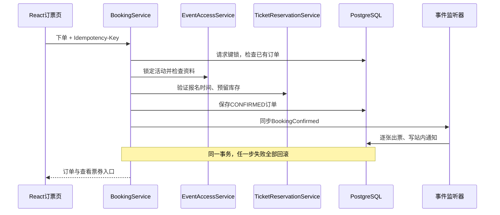
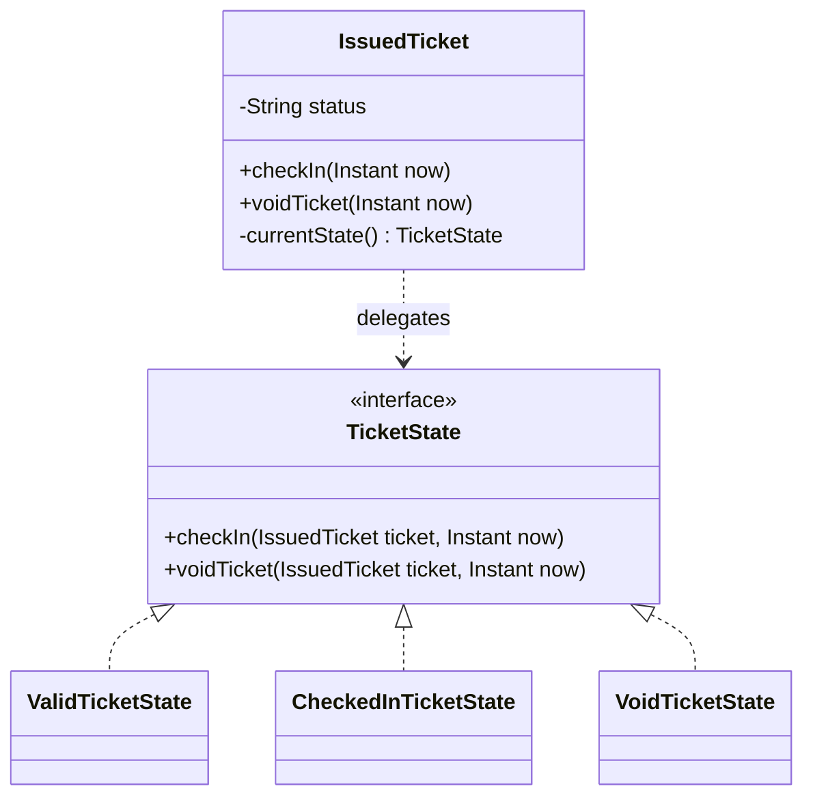
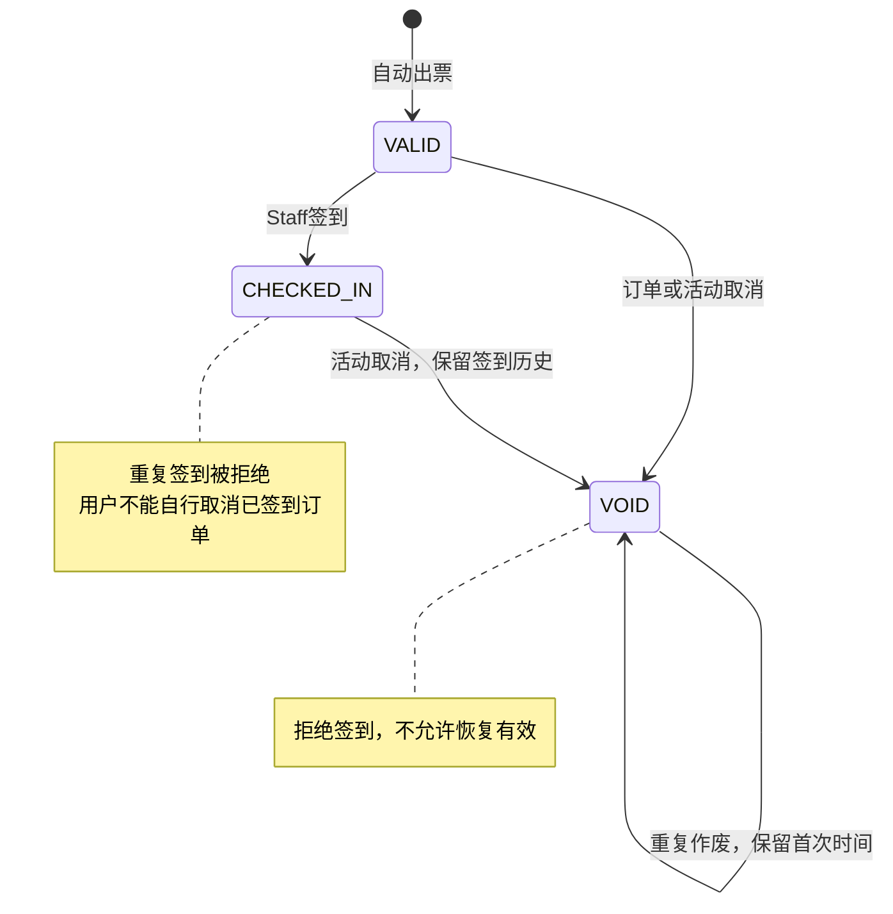
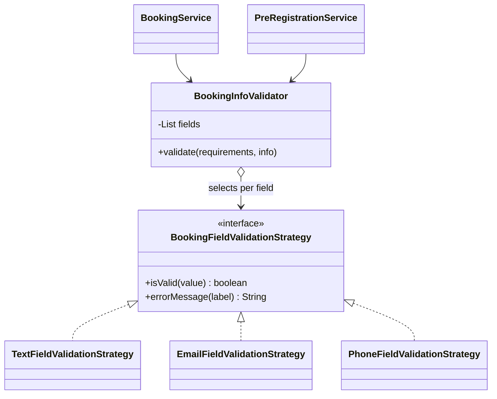

# Presentation准备与设计讲解

正式演示：**2026-10-27 10:30 SGT**。计划正文约38分钟、2分钟缓冲，另5分钟Q&A。当前业务范围为免费票，应用已功能冻结。完成状态和日期只维护在[交付清单](remaining-work.zh-CN.md)，此文负责讲解与材料结构。

## 待制作材料

维护者于2026-10-20确认演示/敏捷材料尚未制作。先汇总真实证据，再制作slides及附录；不补造历史工时或燃尽数据。

| 材料 | 必须对应的内容 |
|---|---|
| 项目与范围 | 四角色、免费票闭环、proposal范围变更及实际里程碑 |
| Analysis → Design | 四角色用例图、核心分析对象、设计类、预订序列、票券状态与核心ERD的对应 |
| 模式决策 | Observer、State、报名资料校验Strategy的动机、代码、测试及边界 |
| 敏捷过程 | 五个Sprint的真实日期、backlog变更、DoD、Review/Retrospective、成员实际工时及行动项 |
| 测试与质量属性 | 最新测试/覆盖率、授权与并发保护、云端验收、性能基线、恢复验证及适用范围 |
| DevSecOps | PR检查→受测镜像→digest发布→数据库备份→部署→HTTPS检查→DAST；保存一次历史失败与成功记录 |
| Demo与备份 | 多角色操作脚本、专用演示账号/活动、两份独立备份录屏（CI/CD与系统Demo） |

课程要求映射沿用已完成的2026-10-19原始评审：Briefing、`SWE5006 - Practice Project Presentation Guidelines.docx`及`Team10_SWE5006_Assignment_Proposal.pdf`。原proposal为4轮迭代/50人日，并提出1000并发、95%常见请求3秒内的参考目标；团队目前按五个Sprint交付，需说明范围与排期调整。维护者已明确当前容量验证以500 VU为目标，1000作为参考。[优化后复测](acceptance/capacity-500-2026-10-20/README.md)在250 VU出现34次超时，500未执行；演示须说明当前500目标尚未验证通过，不修改原proposal或把参考数字当作已达成成绩。

## 需求与实现映射

| 要求 | 已实现证据 | 展示边界 |
|---|---|---|
| 有复杂度的工作系统 | 订单幂等、库存行锁、出票/通知事务、核销审计和取消联动 | 展示重复请求及失败保护，不能只演示CRUD |
| 模块化单体 | React、一个Spring Boot后端、PostgreSQL；[ADR](adr/0001-modular-monolith.md) | checkin与reporting有跨模块JDBC查询，不声称所有边界完全隔离 |
| 角色与归属 | 当前角色与JWT角色取交集；最后有效管理员并发保护；Staff还需活动分配 | 新权限需重新登录；ADMIN管理活动仍按本人归属 |
| 活动、票与报表 | 发布/取消、活动筛选、票种配额、电子票、有效签到与票种汇总 | 有效签到不是历史入场总量；活动取消后审计保留、有效计数归零 |
| 通知 | 订单、活动、开售提醒、Staff分配及角色变更的站内通知 | 不宣称邮件、短信、WebSocket或自动抢票 |
| 模式 | Observer、State、资料校验Strategy | 定价Strategy随支付延期；静态创建方法不冒称GoF Factory Method |
| 交付与安全 | main自动部署、镜像扫描、备份、公开HTTPS DAST | DAST为未登录被动基线；恢复需人工执行，没有自动回滚 |

适合讲解的需求到实现链路：

| 需求/风险 | 分析对象 | 设计落实 | 验证 |
|---|---|---|---|
| 最后一个名额不能重复售出 | Event、TicketType、Booking | 先锁Event，再核对窗口和库存，事务内创建订单 | `BookingIntegrationTest`并发场景 |
| 请求超时后重试不重复下单 | Booking request、用户、请求键 | `BookingRequestLock` + `(user_id, request_key)`唯一约束；相同键不同参数拒绝 | 同键重试、并发同键、参数冲突 |
| 确认订单应有票和通知 | BookingConfirmed、IssuedTicket、Notification | 发布同步事件；出票/通知监听器加入原事务 | 出票或通知失败整体回滚 |
| 已使用/作废票不能入场 | IssuedTicket、Staff assignment、Check-in record | Staff授权与时段检查，票状态守卫，核销审计 | 重复核销、跨活动、取消竞态 |

## Observer与State

### Observer：订单确认通知多个监听器

- Publisher：`BookingService`调用`ApplicationEventPublisher.publishEvent(BookingConfirmed)`。
- Event：`BookingConfirmed`携带订单与活动ID。
- Observers：`BookingConfirmationListener`出票；`BookingNotificationListener`写站内通知。
- 订单取消发布`BookingCancelled`，`BookingCancellationListener`作废电子票，通知监听器写取消通知。
- 监听同步执行，`Propagation.MANDATORY`要求加入已有事务；任一监听器失败整体回滚。没有消息队列、异步投递或跨服务一致性的承诺。
- 不依赖监听器执行顺序；它们读取已保存订单，分别执行自己的职责。请求幂等和数据库唯一约束共同防止重复结果，Observer模式本身不提供“恰好一次”。

### State：相同操作由票券当前状态决定

`TicketState.fromCode`中的switch仅把数据库字符串映射为状态对象；签到是否合法、作废是否转换/幂等由具体State决定。State对象不保存单张票的数据，因此可以复用无状态单例。Context中的包内方法只负责更新字段；调用方不能绕过公开签到/作废入口直接转换。

边界：用户角色、活动分配、签到时段、活动锁与事务仍由服务/控制器负责；已签到订单禁止个人取消仍由取消流程负责。State不替代授权、并发控制，也不负责支付。无需数据库迁移，原API和历史状态兼容。

### 现场演示顺序（模式讲解约3分钟）

1. 展示Publisher和两个监听器代码，再完成一次免费预订：同一订单出现电子票和通知。
2. 展示State类图及`IssuedTicket.checkIn`委托，再由已分配Staff签到：VALID变CHECKED_IN。
3. 重复签到被拒绝；展示自动化测试证明状态/时间未被错误改写。
4. 使用专用演示活动执行活动取消：票变VOID，原签到审计保留；不能再入场。不要取消真实业务活动。
5. 展示测试结果：监听器故障整体回滚、重试不重复、持久化重载后行为正确、并发签到只成功一次。事务故障通过测试说明，不在演示服务临时改数据库约束。

对应测试：`IssuedTicketTest`覆盖状态转换矩阵；`BookingIntegrationTest`覆盖通知失败/出票失败回滚、同键重试、数据库重载、已签到个人取消拒绝、并发签到及取消竞态。`StaffCheckInIntegrationTest`验证HTTP授权、时段和审计行为。

## Strategy：报名资料校验

应用动机：活动可要求姓名、邮箱、电话、学号、护照号和自定义回答。不同字段采用不同格式/长度算法，普通预订与预登记需要共享这些规则，也必须覆盖绕过HTTP控制器的服务调用。

- Context先执行公共规则：要求的字段不能为空，未要求的个人资料不能提交；之后委托字段绑定的策略检查内容。
- Text策略检查最大长度，普通文本100、自定义回答500；不臆造姓名、护照或学号的格式规则。
- Email策略复用`AttendeeInfo.email`上的Jakarta `@Email`及长度约束，避免与HTTP入口使用不同邮箱正则。
- Phone策略采用已有电话字符及5–30长度规则，共用`AttendeeInfo.PHONE_PATTERN`。这不是短信验证，也不保证号码真实存在。
- 原DTO的Bean Validation仍保留，确保HTTP字段错误响应兼容；策略让直接服务调用也执行内容校验。正常HTTP请求会继续经过服务层策略，但错误邮箱可能已被入口拒绝，不能仅凭页面错误就声称证明Strategy执行。
- Strategy是可替换算法；State是对象生命周期行为。报名字段不同不会导致“状态转换”，票券签到则会改变状态，这是两者在本项目中的区别。

展示建议：选一个要求姓名、邮箱、电话的活动，展示字段→策略绑定，演示有效资料提交；再运行`BookingInfoValidatorTest`证明三种算法及边界、`BookingServiceTest.malformedEmailFromNonHttpCallerNeverReservesInventory`证明绕过HTTP仍拒绝错误邮箱且不占库存。无须支付或新增前端入口。

范围调整表述：原定价Strategy因付费链路延期，本期以报名资料校验Strategy体现可替换算法设计；不将其描述为已完成原定价需求。

## 演示节奏

| 从10:30起 | 内容 | 建议证据 |
|---|---|---|
| 0–4分钟 | Introduction & Project Management | 范围、四角色、五Sprint、真实工时及回顾行动 |
| 4–9分钟 | Analysis & Design / Patterns | 用例→对象→预订序列→Observer/State/Strategy |
| 9–12分钟 | Types of Testing | 一个有意义的失败保护用例及最新报告 |
| 12–24分钟 | CI/CD Pipeline Demo | 历史失败、成功运行、digest镜像、备份部署、HTTPS与DAST |
| 24–38分钟 | System Demo | [业务脚本](sprint-4-demo.zh-CN.md)：发布/分配→订票/QR→核销→统计→取消/通知 |
| 38–40分钟 | 缓冲 | 插问、切屏或重试 |
| 40–45分钟 | Q&A | 事务、模式选择、权限撤销、范围调整及测试局限 |

建议演示活动开始时间为11:05 SGT、结束12:00，签到窗口为10:50–11:20；报名应在演示前开放。演示前各角色重新登录，避免已有JWT临近到期。彩排后再固定实际时间，不通过临时改服务器时钟维持演示。

录屏注明版本和时间，CI/CD与系统Demo分别准备；课程展示材料、验收结果和最终版本tag应相互对应。付费、退款、类别/票种独立销售窗口、邮件短信、CSV财务报表不在本次交付范围。
